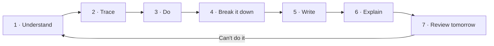

# How to Learn — Visual Notes

Lab only · own machine / own private lab · test data only

Most roadmaps say what to learn. This one says how — so you don't get stuck, memorise without understanding, or quit after two weeks. Method: understand, practise, break down, write, explain, review.

## 1. Learning is a design, not luck

Foundation (fundamentals · Linux · networks) → one brick at a time (one topic · one lab · one note page) → check each brick (explain it? do it tomorrow, no notes?) → no: redo; yes: next brick.

Without the foundation, advanced topics collapse. Ten topics a day = ten weak bricks. Notes are the blueprint — unfindable notes = rebuilding the same brick.

## 2. Watching is not learning

- Watching/reading: feels easy, brain says "I understand" — close the video, can't do it alone. Shallow.
- Doing: harder, slower, sticks — close the notes, can still do it. Deep.

**Honest test per topic:** notes + videos closed, lab task alone, explain it out loud plainly. All three = learned. Any fail = only watched — back to the lab, not another video.

## 3. One tool deep beats ten tools shallow

Beginners collect tool names, can't explain one output fully. Do the opposite:

For one tool: what it is (one sentence) · why used, when not · output line by line · one safe lab example, test data only · your mistakes.

Do that for one tool and the next gets easier — you already know how to learn a tool. Depth first, breadth later.

## 4. Notes are proof, not decoration

- Help future you: in 3 months you'll forget details; good notes rebuild a lab in minutes, not days.
- Prove your work: employers/interviewers trust written proof over "I watched a course".

Copied text, no examples/output/mistakes = not notes. Good notes = your words, example, output, mistakes, questions.

## 5. The method — the loop for every topic

| Step | Do this | Why it earns its place |
|---|---|---|
| 1 · Understand | Read slowly, once. Write 2 sentences: what it is, how it works. Can't? Reread, slower. List open questions — they set your lab tests | Stops empty memorising |
| 2 · Trace | Before running: input, inside, output, security meaning. Guess one changed input's effect — write it first | Guessing trains logic |
| 3 · Do | Own lab only (Kali VM/legal platform), never a real system. Type it yourself, no blind copy-paste, test data only. Save output + date + lab name. Fails? Debug — a skipped error returns | Doing creates real memory |
| 4 · Break it down | Change one thing, rerun (permission 644 → 600, another port, another input). Note changed/unchanged/why. Revert, change another, repeat twice | Logical thinking: inputs, trusted parts, failure points |
| 5 · Write | Same shape every time: concept as you'd say it, how it works, lab example + output line by line, changes + results, security meaning, mistakes, open questions. Copied? Rewrite it | Writing creates proof |
| 6 · Explain | 2–5 minutes, English, recorded or to an imaginary friend: learned, how it works, lab done, output meaning. Listen back — "I don't know why" = redo step 1 | Communication skill — reports + interviews test it |
| 7 · Review | Next day, 10 min: re-read notes, retry the lab blind. Can = done. Can't = repeat understand/do/write today | Review stops forgetting |

## 6. When something fails in the lab

Failure is normal. Debug in order:

1. **Read the full error, line by line** — file, line, command. Copy it exactly; don't paraphrase.
2. **Check the basics:** right folder (`pwd`, `ls -l`)? file exists, or assumed? right command (`python3` vs `python`)? typed exactly, capitals included? Linux is case-sensitive — many "broken" labs are typos.
3. **Make it smaller:** smallest working version; long script → one line at a time, head first, then terminal.
4. **Docs for that one command/tool** — `--help`, `man`, official docs — before a random blog post.
5. **One fix at a time,** noting each try + result. Five at once = never knowing which worked.
6. **Still stuck? Ask specifically:** not "it's not working", but "this command, this folder, expected this, got this error, tried these two things — what next?"
7. **Solved? Save error + fix.** Future you will meet it again; good notes save hours.

## 7. What a good lab write-up looks like

Output is evidence, not a report. A write-up says:

- Problem + why it matters: plain words, honest severity, no exaggeration.
- Reproduction: exact lab steps.
- Evidence: lab evidence, private details removed.
- Fix idea: change a permission, close a port, check input, update software.
- What you learned: in your own words.

That shape works for one finding or a whole engagement — and it's the shape interviewers recognise.

## 8. A daily structure that survives real life

A repeatable day, with breaks, movement, review — adapt times to your life.

Morning 60–90 min (fresh): new topic — 10 min review, 40–60 min understand + do, 10 min write. Midday 30–60 min, if available: light work only. Evening 60–90 min: lab practice, finish notes, save reports. English 10–15 min: record, listen once, note one sentence to improve. Movement every 50 min: stand, walk, stretch 5–10 min.

**Week:** one topic per weekday · Saturday: one lab engagement + write-up · Sunday: review. Miss a day? Don't double up — continue where you stopped, after a 10-minute review.

## 9. How you know you're improving

**Track weekly:** topics done with notes + lab proof (not just watched) · write-ups · explanations · commits · questions answered + open.

Improving: last week's lab without notes · explaining a topic plainly · tool output line by line · own mistakes found faster, without panicking · notes clearer + shorter.
Slow down signs: copying notes without understanding · can't explain yesterday's topic today · jumping to advanced tools to feel progress.

**Fix:** back one phase, rerun the loop on the weak topic, no new topics until it's solid.

## 10. How this repo itself is designed

Same rules it teaches: structured for fast review · detailed, not shortcut · new words explained plainly at first use · every example lab only, test data · each phase ends with proof to save, not a claim. A file feeling like a shortcut = a design bug — fix with more explanation, lab example, reasoning.

## 11. Start here, today — lab pass

Read `01-roadmap/overview.md` fully → work through Phase 0 → use the section 5 note shape for your first topic → record your first 2-minute explanation.

One topic, one lab, one note page, one explanation. Then repeat — no shortcuts, no rush, one solid step at a time.

---
*Educational use only. All practice must be on systems you own or have written permission to test.*
