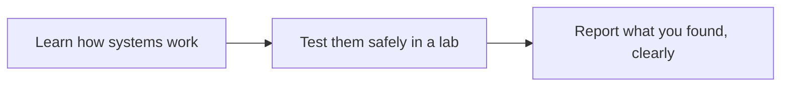
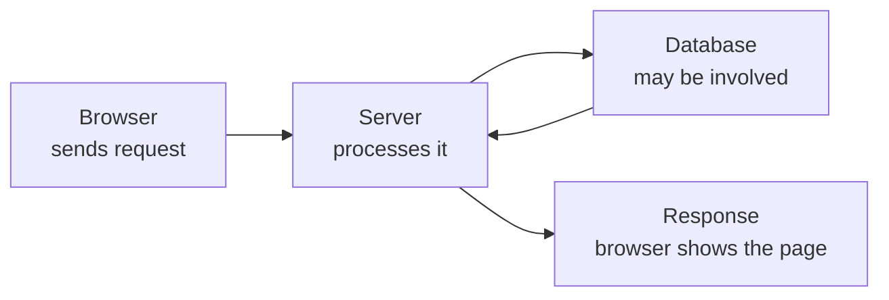
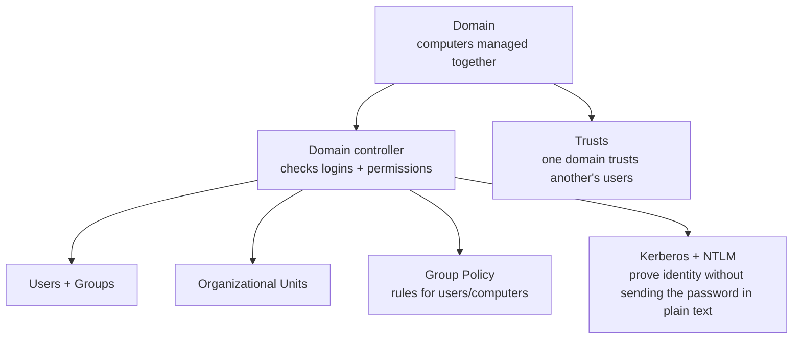

# 01 — Roadmap Overview: Beginner to Advanced — Visual Notes

Lab only · own machine/lab · test data only



Skip part one and the rest falls apart. Every phase follows that order, and detailed files follow it inside each phase too.

| Phase | Leaves you able to… | Maps to |
|---|---|---|
| 0 — Mindset, ethics, lab | Say what red team does/doesn't do, what's in scope, run a working lab | — |
| 1 — Computer + Linux | Files, permissions, processes, filesystem | `02-fundamentals/` |
| 2 — Networking | IP, ports, DNS, HTTP; check your own machine | `03-networks/` |
| 3 — Web + OWASP | Requests, cookies, sessions, OWASP Top 10, lab only | `04-web/` |
| 4 — Systems + AD basics | Windows/Linux systems, Active Directory, plain words | Own AD lab |
| 5 — Tools + techniques | Use tools in your lab, read output, write finding + fix | Lab engagements |
| 6 — Operations, reporting, job prep | Plan engagement, write report, build portfolio | Portfolio |

---

## Phase 0 — Mindset, Ethics, Lab Setup

| Idea | In one line |
|---|---|
| Red team | Tests like an attacker would — with permission — to find weaknesses first |
| Blue team | Defends: watches logs, fixes, responds |
| Purple team | Red + blue together, defence improves from findings |
| Scope | Written agreement: systems, times, methods allowed. Not in writing = not allowed |

**Lab setup:**

- Folders: `projects/` · `notes/` · `reports/` — test data only.

- Kali in VirtualBox/VMware: a second computer inside your real one — break the lab VM, not your real system.
- Terminal prints exactly what a command did, or the error it hit. Read the whole output.
- One-page scope note: VMs, private lab network only, what you will/won't test — the habit that keeps you legal.
- Can't find last week's report in 30 seconds? Fix the layout first.

**First lab pass:**

```bash
pwd      # where am I? check before deleting anything
ls -l    # permissions, owner, size, date — first column = permission string
whoami   # which user am I running as?
```

Then create a test folder + file you wrote, `cat` it back, write your scope note.

**Move on when:** you can explain red/blue/scope in plain English, VM + terminal work, scope note + notes system you actually use.

---

## Phase 1 — Computer and Linux Fundamentals

**The machine:** CPU runs instructions · memory holds running data · disk holds saved files · OS manages all three.

**Filesystem, as a building:**

| Path | Room |
|---|---|
| `/` | Entrance — top of everything |
| `/home` | Users' personal folders |
| `/etc` | Control room — system settings |
| `/var` (+ `/var/log`) | Logs + changing data |
| `/tmp` | Temporary files |
| `/usr`, `/bin`, `/sbin` | Programs + system tools |

Don't flip switches in a control room blind — same rule for `/etc`.

**Permissions = a design, not just numbers:**

| Number | Means | Ask first |
|---|---|---|
| `775` (folder) | Owner full, group full, others read + open, not change | Who needs to read? Who needs to change? Who shouldn't see it? |
| `600` (private file) | Owner read + write only | Same three questions |

Check with `ls -l` first; change safely in your own lab with `chmod`.

**Processes + ports — read the output:**

Process = a running program (`ps`); service = a program waiting, often listening on a port (`ss -tln`, own machine).

| `ss` line | Means |
|---|---|
| `127.0.0.1:5432` | Localhost only — your machine only. Safer by design |
| `0.0.0.0:5432` | All networks — hard look needed. PostgreSQL, exposed vs local = different risk |

**Daily commands — one deeply per day:**

`cd` · `ls` · `pwd` · `cat` · `mkdir` · `rm` · `cp` · `mv` · `grep` · `find` · `chmod` · `whoami`

Per command: what, when, one lab example, your mistake with it.

**Watch out:** `pwd` + `ls` before any delete; normal user first, root only when you understand why the command needs it.

**Lab pass:** test folder tree, move through it; permissions on project folder + test file, explain `775` vs `600`; audit own machine only (OS, user, permissions, localhost ports), save `audit_report.txt`; draw filesystem, one page, `/`–`/tmp`.

**Move on when:** filesystem + permissions cold; files found; own logs read; processes + localhost ports checked; audit report line by line; 15+ commands without notes.

---

## Phase 2 — Networking Fundamentals

**Pieces:**

| Piece | In one line |
|---|---|
| IP address | Identifies a computer on a network. Private = local network; `127.0.0.1` = this computer only |
| Port | A door: 80 web, 443 secure web, 22 SSH, 5432 PostgreSQL |
| Listening port | Service waiting at that door |
| TCP / UDP | TCP: reliable, checked (phone call; most web traffic). UDP: fast, unchecked (postcard) |
| DNS | Name → IP (phone book): `example.com` → IP |
| HTTP | The conversation: request → response |
| Packets | Data in small pieces, sent, reassembled (Wireshark later) |

**HTTP status codes, at a glance:**

| Code | Means |
|---|---|
| 200 | OK |
| 404 | Not found |
| 403 | Forbidden |
| 500 | Server hit an error |

**Your own machine first:**

| Tool | Use, lab only |
|---|---|
| `ip a` | Your own interfaces + IPs — audit yourself first |
| `ss -tln` | Your listening ports |
| `ping` | Test message to a lab machine: reply + time = reachable; no reply = check network, firewall, typo. Lab only |
| `dig` | DNS questions: what IP a name resolves to. Lab names + learning domains only |
| Wireshark | After HTTP basics, own lab network only — real packets/requests. Illuminating, and exactly why it stays in the lab |

**Design question:**

| `127.0.0.1` service | Designed for local use only |
| `0.0.0.0` service | Accepts any network — risk changes completely |
| Open port alone | NOT a vulnerability — a service being present. Real questions: what service/version? supposed open? patched? exposed to the wrong network? |

**Lab pass:** `ip a`, `ss -tln`, `ping 127.0.0.1` — explain each output. If a course guides you, start a local web server, check port + localhost-only or not, then stop it. Draw your lab network: computer, server, router, IPs + ports labelled.

**Move on when:** IP/ports/DNS/TCP/UDP/HTTP in plain English; labelled lab network drawn; own ports audited (localhost-only vs exposed); web request walked browser → server → back.

---

## Phase 3 — Web Fundamentals and OWASP

**Flow:**



| Part | Holds |
|---|---|
| Request | Method (GET, POST), URL, headers, body |
| Response | Status code, headers, body |
| Cookies | Small data stored in the browser |
| Sessions | Keep you logged in without re-asking your password every page |

Authentication checks who you are; a session keeps that answer alive across pages. Weak sessions → problems follow.

**OWASP Top 10:**

| Item | Means |
|---|---|
| Broken access control | User reaches something they shouldn't |
| Cryptographic failures | Sensitive data not protected properly |
| Injection | Input trusted and run as code/query, not plain data |
| Insecure design | Design missed security checks from the start |
| Security misconfiguration | Defaults, open debug pages, extra features left on |
| Vulnerable components | Old libraries/software, known problems, not updated |
| Identification + authentication failures | Weak login/session/password handling |
| Software + data integrity failures | Updates/data trusted without genuineness checks |
| Logging + monitoring failures | Attacks not logged or not noticed in time |
| Server-side request forgery | Server tricked into requests it shouldn't make |

Per item: plain meaning, lab observation, how you'd report it, how a developer would fix the design — never a real exploit against a real site.

**Tools (lab/legal platforms only):**

| Tool | Shows |
|---|---|
| Browser dev tools | Requests, responses, cookies, page code — what the browser hides |
| `curl` | Terminal request; headers + body, exactly what the server sent |
| Burp Suite Community | Between browser + lab server: see/change requests in the lab |

**Carry everywhere:** where does input enter, get checked, get used? Follow it like water through pipes — where it leaks, there's a problem. Normal behaviour first: map the site (pages, forms, parameters), understand correct use, then change one input at a time. Payload lists first = fastest way to learn nothing.

**Lab pass:** dev tools on your own lab page (request, response, cookies, status). PortSwigger Academy, one OWASP topic at a time, in your own words. If a course guides you, build a test page with a form, follow input form → response in your own code. One write-up per topic: meaning, observation, fix.

**Move on when:** requests/responses/cookies/sessions/database role explained; each OWASP item plain words + lab concept; 3+ write-ups off-page; dev tools + curl output explained.

---

## Phase 4 — Systems and Active Directory Basics

Real companies run many computers, managed together. Active Directory is how many Windows networks manage users, computers, permissions together. Basics here, not advanced AD attacks.

Windows: users, groups, services, registry concept, PowerShell basics, event log concept. Linux (deeper): users, groups, sudo concept, services, cron concept, logs in `/var/log`.

**AD, in plain words:**



**Why AD matters:** who has permission to what, and why? Most AD problems are permission design problems: too many admins, old accounts active, over-powered service accounts, weak password policy. Lateral movement (one computer → another) follows from that design. Learn concept + lab defence first.

| Tool | Use, own lab only |
|---|---|
| PowerShell | Windows command tool, like a Linux terminal for Windows. Own Windows lab VM only |
| BloodHound | AD relationships as a graph — who can reach what. Hard as a list, easy as a map. Own AD lab only |
| Own audit | Python system audit + `ps`, `ss`, log checks, on your own machine |

**Lab pass:** build slowly — one DC VM, one or two client VMs, private lab network, owned by you, never on a real network. Test users/groups yourself, test passwords only, check read/change rights, draw the map. Logs matter: blue teams watch them; a good test is detectable + explainable, not hidden.

**Move on when:** domain/DC/user/group/OU/Group Policy simply; small private lab diagram explained; Windows + Linux permissions checked + explained; lab report (findings + fixes) in your own words.

---

## Phase 5 — Red Team Tools and Techniques (Lab Only)

Now — only now — tools make sense: systems/networks/web/AD known, so tools are lab helpers, not magic. Correct + safe use, clear reporting — not tool collecting.

**Categories:**

Order: recon → initial access → privilege escalation → lateral movement (all in your lab).

| Category | Means, lab only |
|---|---|
| Recon | Info on a lab target you own: services, pages, versions |
| Initial access | How a test starts: weak lab login, lab web/service problem — scope written down first |
| Privilege escalation | Low-permission lab account → higher permission via lab misconfiguration — and its fix |
| Persistence + defence evasion | Concepts to understand; defenders watch for them; a professional test must be detectable + reported, not hidden |
| Lateral movement | Phase 4 permission-design question, across machines |

**Tools:**

| Tool | Asks / does, lab only | Reading the answer |
|---|---|---|
| Nmap | Maps a lab network you own: open ports, answering services | Open port = service present, not automatically vulnerable — check service + version next |
| ffuf / Gobuster | Directory/parameter discovery for lab sites you own: tries common page names | Found page raises: should it be public, or not? |
| Metasploit | Framework, lab modules for vulnerable lab machines made for learning | Shows how a known lab vulnerability works, controlled, and how to fix it. Never real systems |
| Burp + BloodHound | Return here, deeper, same lab-only way | Same rules: scope first, lab only |

**Professional rules:**

1. Scope first, report last. No scope, no test. No report, no professional value.
2. A tool is a question, not an answer: Nmap asks what listens; you decide should it listen, to whom, patched, needed.
3. One change at a time — change five, something breaks, you won't know which.
4. Per attack concept, learn the defence: blue-team log detection, developer fix. Attack-only = half a professional.

**Lab pass:** Nmap a network you own (services + versions); directory-tool a website you own (public vs private by design); one complete lab engagement (legal platform/own vulnerable VM) — scope, recon, test, finding, report, fix — in your portfolio folder, private details removed.

**Move on when:** each category + one tool in each, deeply; 3+ engagements talked through (scope, findings, fixes); a finding explained (impact + fix); portfolio reports proud to show, private details removed.

---

## Phase 6 — Red Team Operations, Reporting, Job Preparation

Skills without proof don't get jobs. A portfolio of clear, honest lab work + clear communication is what interviewers check.

**Planning:**

Scope in writing (systems, times, methods) · time plan · stop rules (what if something goes wrong) · communication plan (real-job context: who to tell, when, how) · safety plan (report a serious problem immediately).

**Reporting — two readers:**

Two readers: manager (plain-words summary) + technical reader (reproduction + fix details).

- Executive summary: what was tested, found, what matters most.
- Each technical finding: title, lab severity, plain meaning, impact, lab reproduction steps, evidence (private details removed), fix suggestion.
- Appendix: scope, lab tools, timeline.
- Language: clear, honest, no exaggeration. Low impact in the lab? Say low. Honesty builds trust, and trust is the job.

**Portfolio + resume:**

- Best 3 projects first, clear READMEs — not 20 unfinished ones. Visitor understands in 30 seconds, finds proof in 3 minutes.
- GitHub repos with real projects: password lab, system audit, lab write-ups — each with scope, method, finding, fix, what you learned.
- Resume: proof links, not bare skill names — a Python system audit on your own machine + link + report sample beats the word "hacking" alone.

**Interview prep:**

- Explain a lab project in 3 minutes, no notes: tested, found, fix, what you'd do differently.
- Honest about what you don't know yet + what you're learning next — respected more than pretending.
- Certifications after proof, not before: eJPT/PNPT (practical beginner), then OSCP (deeper), CRTP (AD focus later). A certificate proves a test passed; it doesn't replace labs.

**Lab pass:** polish one report to portfolio quality; one-page portfolio README; mock interview on one project; job-skill map — 10 jobs you like, skills asked, portfolio item proving each, gap remaining. Beats 100 identical applications.

**Done when:** 3 polished lab reports (scope, findings, fixes); GitHub portfolio, clear, with safety notes; a best project explainable in 3 minutes, plain English; a job-skill map + next step; learning doesn't stop — new tools/problems/designs arrive yearly, this method still applies.

---

## What comes next after this file?

Later commits turn each phase into detailed files:

`02-fundamentals/` (computer basics, filesystem, commands) · `03-networks/` (basics, tools + output meaning) · `04-web/` (web basics, OWASP) · `05-tools/` (overview, recon, web, password + system tools, lab only) · `06-practice/` (safe labs, practice notes, routine) · `07-resources/` (books, courses, glossary).

Don't skip phases — one big commit, one phase at a time, with the method from `how-to-learn.md`.

---
*Educational use only. All practice must be on systems you own or have written permission to test.*
