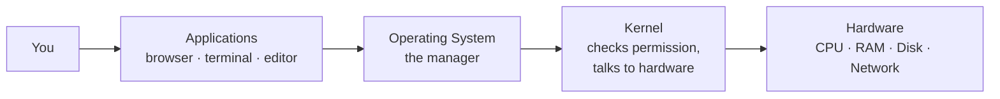
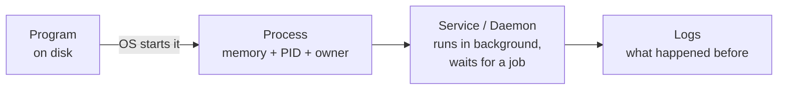
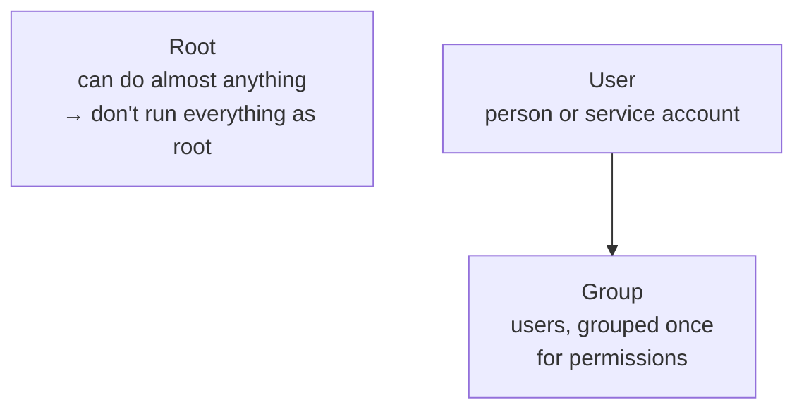
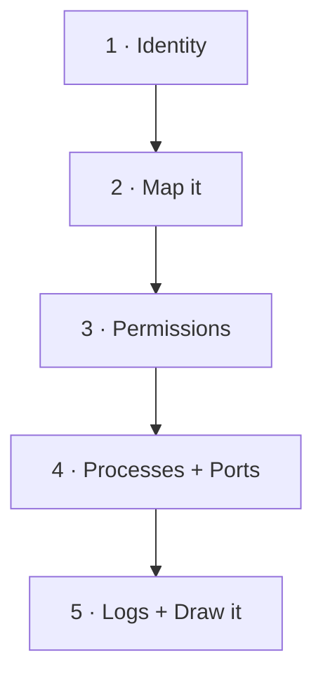

# Computer Basics — Visual Notes

Lab only · own machine · test files only

## 1. The machine, in one diagram



| Part | Job, in one line | Gone when power off? |
|---|---|---|
| **CPU** | The worker — runs instructions, one at a time, very fast | — |
| **RAM** | The desk — holds what is running right now | Yes |
| **Disk** | The filing cabinet — keeps files, programs, OS | No |
| **OS** | The manager — gives time, desk space, access | — |
| **Kernel** | Core of OS — only part that touches hardware directly | — |
| **Shell** | Translator — your typed words → OS (Bash on Linux) | — |

**Program vs process — don't mix them:**
- Program = instructions on disk
- Process = that program, alive, with memory + PID

## 2. Layers — who talks to whom

```
User
  ↓
Applications
  ↓
Operating system
  ↓
Kernel  ← permission checkpoint here
  ↓
Hardware
```

> Normal programs never touch hardware directly. They ask the kernel. Kernel checks permission first. That's the whole security model, in miniature.

## 3. Files and paths

| Word | Means |
|---|---|
| File | Data + name + location + owner + permissions |
| Folder | A file that lists other files |
| Path | Address in the tree |

```
/home/your-user/projects/notes.txt
  │      │          │         │
  root   home     user      file
```

| Type | Read with |
|---|---|
| `.txt` / `.md` | `cat` — plain text |
| `.py` / `.sh` | `cat` — code / script |
| `.log` | `cat` / `tail` — event records |
| Binary (program, image) | Don't `cat` and guess — use the right tool |

**Audit rule:** checking a file's permissions is usually enough. Don't read private contents.

## 4. Processes and services



**Check your own machine:**

```bash
ps aux | head -20   # what is running now
ss -tln             # what is listening
```

| `ss` output | Means |
|---|---|
| `127.0.0.1:5432` | Localhost only — safer, this machine only |
| `0.0.0.0:5432` | All networks — check it, justify it, don't ignore it |

Read one `ps` line at a time: owner → PID → command → expected here?
Don't recognise it? Look it up first. Don't kill it first.

## 5. Users, groups, permissions



| | Read | Write | Execute |
|---|---|---|---|
| Value | 4 | 2 | 1 |

**Read a permission number:**
```
775  =  owner rwx  ·  group rwx  ·  others r-x
644  =  owner rw-  ·  group r--  ·  others r--
600  =  owner rw-  ·  group ---  ·  others ---
```

Before changing any permission, answer:
1. Who needs to **read** this?
2. Who needs to **change** this?
3. Who should **not** see it at all?

Can't answer? Design isn't finished yet.

Full depth → `linux-filesystem.md`

## 6. Linux vs Windows, at a glance

| | Linux | Windows |
|---|---|---|
| First | Terminal-first | GUI-first, PowerShell = Bash equivalent |
| Filesystem | Starts at `/`, no drive letters | `C:\Users\...`, drive letters |
| Permissions | Central, owner/group/others | Users, groups, directory services |
| Logs | `/var/log` | Event Logs |
| Learn order | **First, deeply** | Basics next, in your own lab VM |

Real networks are usually both: Linux servers + Windows office machines.

## 7. Size up a new box — 5 checks, in order



| # | Check | Command, own machine only |
|---|---|---|
| 1 | Who / where am I? | `uname -a` · `hostname` · `whoami` · `pwd` |
| 2 | What's here? | `ls /` · `ls -l /home` |
| 3 | Who can read / change it? | `ls -l` on project folder + one test file, read it back in plain words |
| 4 | What's running / listening? | `ps aux \| head -20` · `ss -tln` — localhost or exposed? |
| 5 | What happened? + Draw it | Last 20 lines of your own lab log · draw CPU / RAM / Disk / OS / Users, with arrows |

Then explain the drawing out loud, without notes. The part you can't explain = redo it. That's the work, not slow work.

## 8. Lab pass — try it now

```bash
mkdir -p ~/lab-test
echo "This is a test file I made myself." > ~/lab-test/test.txt
ls -l ~/lab-test/test.txt
cat ~/lab-test/test.txt
```

Read the `ls -l` line back: name · size · owner · permissions · what they mean.
Then `ps aux | head -20` and `ss -tln` — for each port: localhost-only, or exposed?

**Watch out:**
- RAM ≠ Disk (desk ≠ filing cabinet)
- Don't run everything as root — a mistake as root breaks more
- Don't kill a process you haven't identified
- Read the full error, don't retry the same command blindly

**Done when you can:** explain CPU, RAM, disk, OS, kernel, shell, program, process, service, file, folder, user, group — in plain English, and explain every line of the checks above.

Next → `linux-filesystem.md`

---
*Lab only: systems you own or have written permission to test, test data only.*
