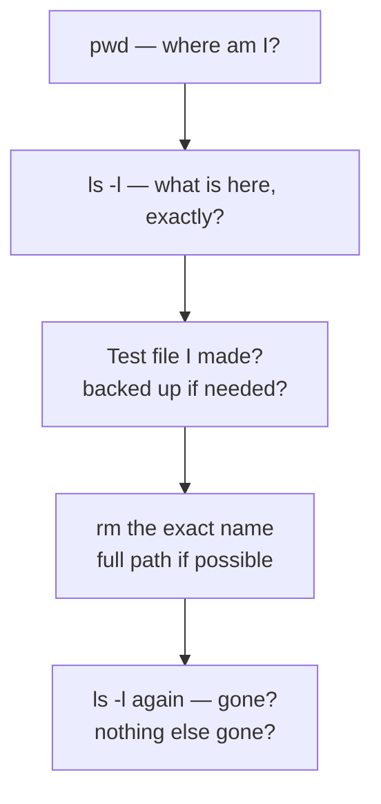
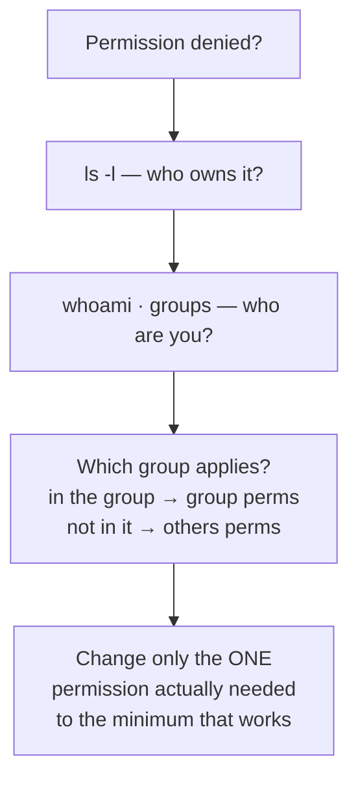
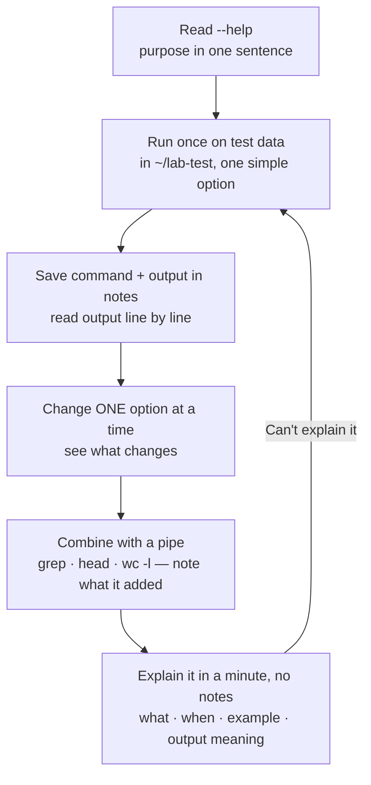

# Linux Commands — Visual Notes

Lab only · own machine · test files in `~/lab-test`

## 1. How a command is built

```
command [options] [arguments]
   │         │          │
   what      how        what to
   to do     to do it    do it to
```

| Example | Means |
|---|---|
| `ls` | List |
| `ls -l` | List, long form — permissions, owner, size |
| `ls -a` | List, including hidden files starting with `.` |
| `ls /home` | List that folder |

Don't memorise every option — remember purpose, check details when needed:

```bash
ls --help   # short version, usually enough
man ls      # full manual — q quits
```

`q` also quits `less` and `top`.

## 2. Navigate — where am I, what's here?

| Command | Purpose | Example | Output means |
|---|---|---|---|
| `pwd` | Where am I standing? | `pwd` | Full path, e.g. `/home/your-user` — check it before any create, move, delete, or permission change |
| `ls` | What names are here? | `ls` | Names only |
| `ls -l` | Audit form | `ls -l ~/lab-test` | Permissions, owner, group, size, time, name, one per line |
| `ls -a` | Include hidden files | `ls -a` | Shows dotfiles like `.bashrc` — hidden = settings file, not secret |
| `ls -ld folder` | Details of the folder itself | `ls -ld ~/lab-test` | Not its contents |
| `cd ~/lab-test` | Go to lab folder | `cd ~/lab-test` | `~` = home |
| `cd ..` | Up one folder | `cd ..` | — |
| `cd -` | Back to previous folder | `cd -` | Handy jumping between two places |
| `cd ~` / bare `cd` | Go home | `cd` | Both go home |

Read one `ls -l` line (full detail → `linux-filesystem.md`):

```
-rw-r--r-- 1 your-user your-user 38 Nov  1 12:00 test.txt
```

`-` = regular file · `rw-` = owner read+write · `r--` = group read only · `r--` = others read only · then owner, group, size in bytes, name.

**Watch out:** Linux is case-sensitive — `Lab-Test` and `lab-test` are different folders, so `ls` first for exact spelling. And a failed `cd` ("no such file or directory") leaves you where you were — run `pwd` to confirm you actually moved before running the next command.

## 3. Read files — pick the right tool

| Command | When | Example | Keys / output |
|---|---|---|---|
| `cat` | Small text file only | `cat ~/lab-test/a.txt` | Whole file, exactly as written |
| `less` | Large file, e.g. logs | `less ~/lab-test/a.txt` | Space next page · `b` previous · `/word` search · `q` quit |
| `head -20` | First lines | `head -20 ~/lab-test/a.txt` | First 20 lines |
| `tail -20` | Last / most recent lines | `tail -20 ~/lab-test/a.txt` | Last 20 lines |
| `tail -f` | Follow live | `tail -f ~/lab-test/a.txt` | New lines as file grows — `Ctrl+C` stops |

```bash
mkdir -p ~/lab-test
echo "Hello lab, this is a test line." > ~/lab-test/a.txt
cat ~/lab-test/a.txt
```

Reach for `head`/`tail` first on a big file, then `less` to search inside it — not `cat` on ten thousand lines. Don't `cat` a binary or private file.

## 4. Create, copy, move, delete

| Command | Purpose | Example | What happens |
|---|---|---|---|
| `mkdir` | Make a folder | `mkdir ~/lab-test/myfolder` | One folder, parent must exist |
| `mkdir -p` | Make nested folders | `mkdir -p ~/lab-test/a/b/c` | Builds whole chain, no error if it exists |
| `touch` | Empty file, or update time | `touch ~/lab-test/notes.txt` | Size 0 is normal, not broken; writes no content |
| `cp` | Copy | `cp ~/lab-test/a.txt ~/lab-test/a-backup.txt` | Original stays; copy before a risky change, change the copy |
| `cp -r` | Copy a folder | `cp -r ~/lab-test/myfolder ~/lab-test/myfolder-copy` | `-r` = recursive; without it `cp` errors on a folder |
| `mv` | Move, or rename | `mv ~/lab-test/a.txt ~/lab-test/b.txt` | Original disappears from old place |
| `mv` into folder | Move keeping name | `mv ~/lab-test/b.txt ~/lab-test/myfolder/` | Verify with `ls -l` in both places |
| `rm` | Delete, permanently | `rm ~/lab-test/delete-me/temp.txt` | No trash bin, usually can't be undone |
| `rm -r` | Delete a folder + contents | `rm -r ~/lab-test/delete-me` | `-r` required for folders |

Safe delete routine, every time:



**Watch out:** never type casually — `rm -rf /`, `rm -rf ~`, `rm -rf *` (everything here — why `pwd` first matters), or `rm -rf $FOLDER` unchecked (`echo $FOLDER` first). For wildcards, run `ls *.txt` first and only `rm` if that list is exactly what you intend.

## 5. Find things — search text, find files, recall commands

| Command | Purpose | Example | Output means |
|---|---|---|---|
| `grep "lab" file` | Lines matching text | `grep "lab" ~/lab-test/search.txt` | Prints only matching lines, e.g. just `hello lab`, not the whole file |
| `grep -i` | Ignore case | `grep -i "LAB" ~/lab-test/search.txt` | `lab` and `LAB` both match |
| `grep -r` | Search a folder + subfolders | `grep -r "hello" ~/lab-test/` | Recursive |
| `find -name` | Find by name | `find ~/lab-test -name "*.txt"` | Quote the pattern, so the shell doesn't expand `*` first |
| `find -type f` | Files only | `find ~/lab-test -type f` | — |
| `find -type d` | Folders only | `find ~/lab-test -type d` | — |
| `which` | Where is this command? | `which python3` → `/usr/bin/python3` | Where, not what; `ls -l $(which python3)` shows permissions + owner |
| `history` | What did I run before? | `history \| tail -20` | Last 20 commands — check `pwd` + arguments before rerunning one |

```bash
echo "hello lab" > ~/lab-test/search.txt
echo "second line with test word" >> ~/lab-test/search.txt
echo "third line" >> ~/lab-test/search.txt
grep "lab" ~/lab-test/search.txt
```

Quote patterns with spaces or wildcards: `grep "hello lab" file`, not `grep hello lab file`. `grep` is for text files only. Start `find` in a folder you own, like `~/lab-test`, not `/`.

## 6. Permissions — commands + who you are

| Command | Purpose | Example | Output means |
|---|---|---|---|
| `chmod 600 file` | Owner read/write only | `chmod 600 ~/lab-test/perm.txt` | Private design |
| `chmod 644 file` | Owner read/write, others read | `chmod 644 ~/lab-test/perm.txt` | Ordinary public text file |
| `chmod u+x file` | Symbolic form | `chmod u+x ~/lab-test/perm.txt` | Add execute for owner — pointless for a text file, just shows symbolic form |
| `whoami` | Who am I? | `whoami` | Your username |
| `id` | IDs + groups | `id` | User ID, group ID, groups, numbers + names |
| `groups` | Group names only | `groups` | Group names only |

```bash
echo "test" > ~/lab-test/perm.txt
ls -l ~/lab-test/perm.txt
chmod 600 ~/lab-test/perm.txt; ls -l ~/lab-test/perm.txt
chmod 644 ~/lab-test/perm.txt; ls -l ~/lab-test/perm.txt
```

Always `ls -l` before and after `chmod`. Full theory → `linux-filesystem.md`.



Don't use `chmod 777` as a fix — it opens the file to everyone. `chmod` changes permissions (mode); `chown` changes owner and normally requires root — different jobs, different commands. Don't practise permission changes on system files.

## 7. System info + processes — own machine only

| Command | Purpose | Example | Read it as |
|---|---|---|---|
| `uname -a` | Kernel + machine | `uname -a` | Kernel, version, architecture like `x86_64` — note it, don't memorise it |
| `hostname` | Machine name | `hostname` | — |
| `ps aux \| head -20` | What's running? | `ps aux \| head -20` | First 20 lines for readability |
| `ps aux \| grep python3` | Filter processes | `ps aux \| grep python3` | The `grep` process itself shows up too — ignore that line |
| `ss -tln` | What's listening? | `ss -tln` | `-t` TCP · `-l` listening · `-n` numbers, not names |
| `top` / `htop` | Live processes | `top` | Updating, sorted by CPU/memory — `q` quits |

`ps` columns: USER · PID · %CPU · %MEM · COMMAND. Don't kill a process by PID before learning what it is. Inside `top`, don't press keys randomly until you've read `man top` — some keys can kill processes.

| `ss` output | Means |
|---|---|
| `127.0.0.1:5432` | Localhost only — safer, this machine only |
| `[::1]:5432` | IPv6 localhost equivalent |
| `0.0.0.0:5432` | All IPv4 networks — check it carefully in a lab design |

An open port alone doesn't mean vulnerable; it means a service is present. Next: what service, what version, should it be open, to whom, is it patched?

## 8. Combine commands — pipes, counts, chaining

```mermaid
flowchart LR
    A[Command 1<br/>produces output] -->|pipe \|<br/>output becomes input| B[Command 2<br/>filters / counts / sorts it]
    B --> C[Final output<br/>only what matters]
```

| Pattern | Example | What it does |
|---|---|---|
| Filter a listing | `ls -l ~/lab-test \| grep ".txt"` | List, then only `.txt` lines |
| Filter processes | `ps aux \| grep python3` | Processes, then only Python lines |
| First lines | `ps aux \| head -20` | Processes, then first 20 lines |
| Count matches | `grep "lab" ~/lab-test/search.txt \| wc -l` | Matching lines → a number, e.g. `1` |
| Count names | `ls ~/lab-test \| wc -l` | Names listed → a number |
| Unique values | `sort file \| uniq` | Sorted lines, duplicates removed (adjacent only, so `sort` first) |
| Count uniques | `sort file \| uniq \| wc -l` | Unique lines → a number |

Small tools, each doing one job well, chained together.

Chaining — `&&` vs `;` matters:

| Form | Means | Use when |
|---|---|---|
| `mkdir -p ~/lab-test/chain && cd ~/lab-test/chain && pwd` | Next runs only if previous succeeded | Dependent steps — if `mkdir` fails, `cd` never runs, you don't end up in the wrong folder |
| `cd ~/lab-test ; ls -l` | Next runs regardless | Truly independent steps only — a failed `cd` still runs `ls` in the old folder, and that output can mislead you |

Verify with `pwd` after any `cd`.

## 9. Redirection — `>` replaces, `>>` adds

```mermaid
flowchart LR
    A["echo 'first line' > out.txt"] --> B[out.txt = first line only]
    B --> C["echo 'second line' > out.txt"] --> D[out.txt = second line only<br/>first line GONE"]
    E["echo 'first line' > out2.txt"] --> F["echo 'second line' >> out2.txt"] --> G[out2.txt = both lines, in order]
```

| Form | Means |
|---|---|
| `>` | Replace — back up anything important before redirecting into it |
| `>>` | Append — how you build a report line by line |
| `<` | Input from a file, e.g. `grep "lab" < ~/lab-test/search.txt` — arrow = data flow direction; most commands take a filename directly |

```bash
echo "Hello lab"
echo $HOME          # prints your home path — $HOME is a variable
echo '$HOME'        # prints literal $HOME — single quotes don't expand
echo "$HOME"        # expands — quote variables in scripts until quoting is automatic
```

## 10. Edit in the terminal — `nano`

`nano` shows its shortcuts on screen — easier than `vim`, which has modes.

| Key | Does |
|---|---|
| Type + arrow keys | Write + move normally |
| `Ctrl+O`, then Enter | Save (write out), same filename |
| `Ctrl+X` | Exit — if unsaved, asks "Save modified buffer?" `Y` yes / `N` no / `Ctrl+C` back to editing |
| `Ctrl+K` | Cut a line |
| `Ctrl+U` | Paste it back |

Save first, exit second, verify with `cat`. The common loss: answering `N` at the prompt without saving.

```bash
nano ~/lab-test/notes.txt
cat ~/lab-test/notes.txt
```

## 11. Learn any new command — the loop



Try one common mistake safely in the lab, note the error and the fix. If you can't explain it, repeat the lab run today, and again tomorrow without notes.

## 12. Lab pass — try it now, in order

```bash
# Navigate
pwd; ls; ls -l; ls -a
cd ~/lab-test; pwd; cd ..; pwd; cd -; pwd; cd ~; pwd
# Read
echo "line one" > ~/lab-test/read.txt
echo "line two LAB" >> ~/lab-test/read.txt
echo "line three" >> ~/lab-test/read.txt
cat ~/lab-test/read.txt; head -2 ~/lab-test/read.txt; tail -2 ~/lab-test/read.txt
grep "LAB" ~/lab-test/read.txt; grep -i "lab" ~/lab-test/read.txt
grep "lab" ~/lab-test/read.txt | wc -l
# Create, copy, move, delete
mkdir -p ~/lab-test/practice/a/b
touch ~/lab-test/practice/a/b/f.txt; echo "test" > ~/lab-test/practice/a/b/f.txt
cp ~/lab-test/practice/a/b/f.txt ~/lab-test/practice/a/b/f-backup.txt; ls -l ~/lab-test/practice/a/b/
mv ~/lab-test/practice/a/b/f-backup.txt ~/lab-test/practice/; ls -l ~/lab-test/practice/
pwd; ls -l ~/lab-test/practice/a/b/; rm ~/lab-test/practice/a/b/f.txt; ls -l ~/lab-test/practice/a/b/
# Permissions + system, own machine only
chmod 600 ~/lab-test/practice/f-backup.txt; ls -l ~/lab-test/practice/
whoami; id; uname -a; hostname
ps aux | head -20; ss -tln
# Combine + edit
ls -l ~/lab-test | grep ".txt"
ps aux | grep python3 | head -5
cat ~/lab-test/read.txt | sort | uniq | wc -l
nano ~/lab-test/notes.txt   # write 3 lines, Ctrl+O, Enter, Ctrl+X, then:
cat ~/lab-test/notes.txt
```

For each output, say what it did and where you ended up; for each pipe, what it added; for each port, localhost-only or exposed.

**Watch out:**
- `>` replaces — `>>` adds; losing old content to `>` is a mistake you make once, then remember
- `rm` is permanent, no trash bin — `pwd` + `ls -l` first, every time
- Don't kill a process you haven't identified, and don't change permissions on files you don't own or don't understand

**Done when you can:** use `pwd`/`ls`/`cd` in all useful forms and explain absolute vs relative paths; read with `cat`/`less`/`head`/`tail` and know when each fits; create, copy, move, safely delete test files and explain the differences; search with `grep` (`-i`, `-r`) and `find` with quoted patterns; `chmod` and explain why `777` is almost never right; check who you are, system info, processes, localhost ports and explain each output; combine with pipes and explain what each pipe added; use `>` vs `>>` without losing data; edit in `nano`, save, exit, verify.

Next → `03-networks/`

---
*Lab only: systems you own or have written permission to test, test data only. Never delete, move, or change permissions on files you don't own or don't understand.*
