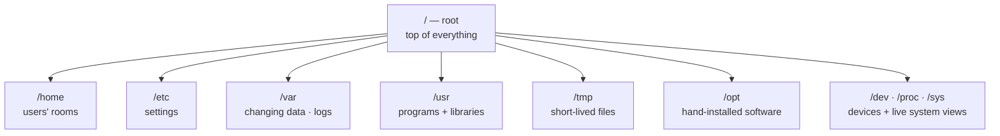
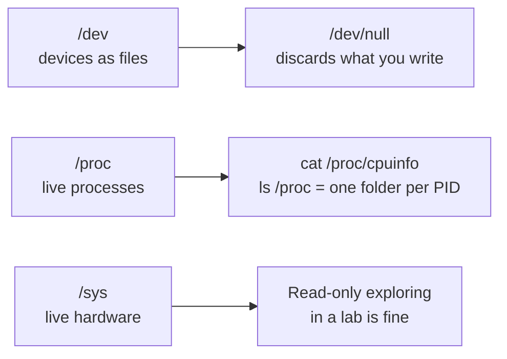
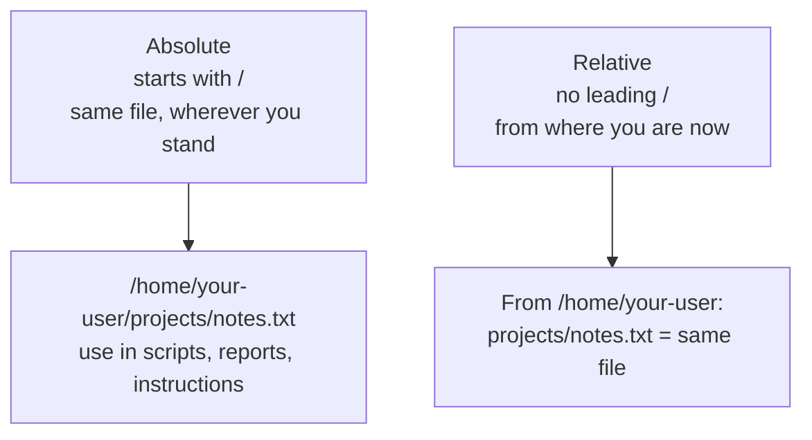
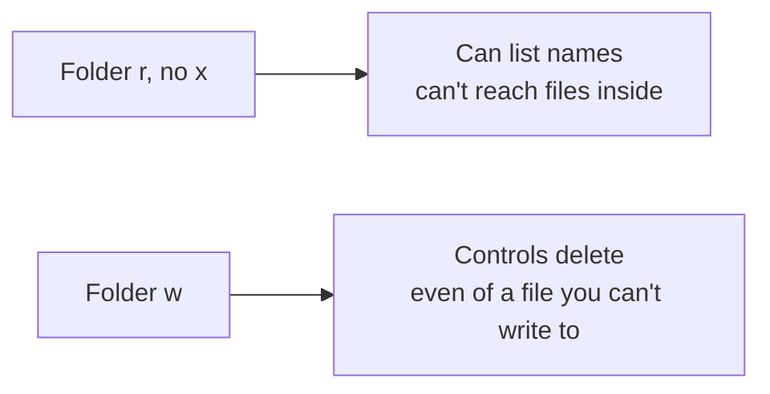
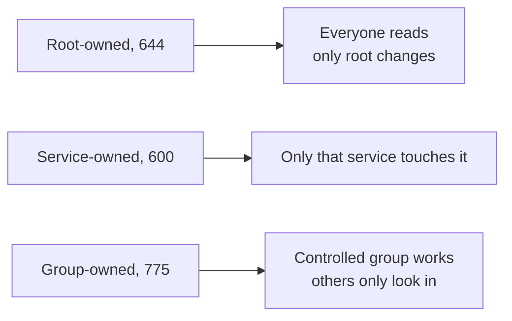
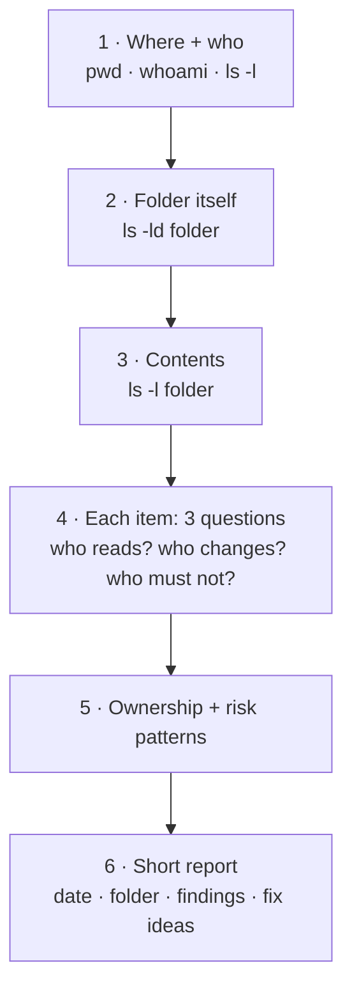

# Linux Filesystem — Visual Notes

Lab only · own machine · test files only

## 1. One tree, one entrance



No drive letters. Everything hangs off `/`.

```
/home/your-user/projects/notes.txt
  │      │          │         │
  root   home     user      file
```

| Idea | Means |
|---|---|
| Path | Address in the tree |
| Folder | A file that lists other files |
| Separation | Users apart from system, settings apart from logs, temp apart from permanent — so one mistake doesn't break everything |

Audit question, every time: is that separation still intact, or has something been opened too wide, mixed up, or left in a temp spot?

## 2. The folders that matter

| Folder | Lives there | Your move |
|---|---|---|
| `/` | Top of everything | Don't create random folders here |
| `/home` | Each user's folder, e.g. `/home/your-user` | Work here |
| `/root` | Root's home only | Normal users don't enter; if one can read it, note it |
| `/etc` | System-wide settings | Back up before changing anything, one line at a time |
| `/var` | Logs, caches, service data | `/var/log` = history book; `/var/lib` = service data |
| `/tmp` | Short-lived files, often cleared on reboot | Never important work, never private data |
| `/usr` | Programs, libraries, docs | `/usr/bin` holds most commands |
| `/bin` | Essential commands: `ls`, `cat`, `cp` | Often linked from `/usr/bin` |
| `/sbin` | Admin commands, e.g. `ip` | Root-owned, not user-writable |
| `/opt` | Hand-installed software | Note what, when, why — untracked = hard to audit |
| `/boot` | Files to start the machine | Don't practise here |
| `/dev` | Devices as files | See §3 |
| `/proc` | Live process + kernel info, not disk files | See §3 |
| `/sys` | Live hardware + kernel info | See §3 |
| `/mnt`, `/media` | Mount points for external drives | — |

```bash
ls /
ls -l /home
ls -ld ~
pwd
```

Exact list varies by system. That's normal.

## 3. `/etc`, `/var`, and the virtual folders

### `/etc` — the control room

| File | Holds |
|---|---|
| `/etc/hostname` | Machine name, plain text |
| `/etc/hosts` | Local name-to-IP mappings, checked before DNS in some cases |
| `/etc/passwd` | Users: ID, group ID, home, shell — no plain-text passwords |
| `/etc/shadow` | Protected password hashes, root only |
| `/etc/ssh/` etc. | One folder per service, if installed in a lab |

```bash
ls -l /etc/hostname
cat /etc/hostname
ls -l /etc/
```

**Watch out:** checking that `/etc/shadow` is root-only is enough for an audit. Never read, copy, or share its contents.

### `/var` — changing data

```bash
ls -l /var/log | head -20
```

Logs are evidence: what happened, when, who, what failed. Don't delete logs to "clean up". A system with no logs, or logs any normal user can rewrite, is hard to defend. A good lab test should also show up in logs.

### `/dev`, `/proc`, `/sys` — everything is a file



| Example | Means |
|---|---|
| `command > /dev/null` | Throw output away |
| `/dev/sda` (name varies) | A disk as a file — never write to it except a disposable test disk in your own lab, never your main disk |
| `cat /proc/cpuinfo` | CPU info, read-only |
| `/proc`, `/sys` writes | Don't "tune" them unless a trusted guide says exactly what, why, and how to undo it |

Read-only for normal users, write only where root genuinely needs it.

## 4. Paths — absolute vs relative



| Shortcut | Means |
|---|---|
| `.` | Here |
| `..` | Up one folder |
| `cd -` | Back to previous folder |
| `~` | Your home folder |
| `$HOME` | Same path, as a variable — `echo $HOME` prints it |
| `~some-user` | That user's home — don't use it to peek into other people's homes |

```bash
pwd
cd ~/lab-test; pwd
cd ..; pwd
cd -; pwd
```

**Watch out:** a relative path in the wrong folder creates or deletes the wrong file. Run `pwd` and `ls -l` before any create, move, or delete, especially in a fresh terminal.

## 5. Read an `ls -l` line

```
-rw-r--r-- 1 your-user your-user 38 Nov  1 12:00 test.txt
 │ │   │   │
 │ │   │   └── others: r--
 │ │   └────── group: r--
 │ └────────── owner: rw-
 └──────────── type: - = file, d = folder, l = link
```

Then: link count · owner user · owner group · size in bytes · last change time · name.

Folder example:

```
drwxrwxr-x 2 your-user your-user 4096 Nov  1 12:00 lab-test
```

`d` = directory, owner `rwx`, group `rwx`, others `r-x` — that's `775` (§6).

## 6. Permissions — letters, folders, numbers

| Letter | File | Folder |
|---|---|---|
| `r` (4) | Read content | List names inside |
| `w` (2) | Change content | Create, delete, rename inside |
| `x` (1) | Run as a program | Enter the folder, reach files inside |

Two catches, test both in a lab:



| Number | Letters | Good for |
|---|---|---|
| `600` | `rw-------` | Private file, personal test notes |
| `644` | `rw-r--r--` | Ordinary public text file, README |
| `755` | `rwxr-xr-x` | Program or folder everyone uses, only owner changes |
| `775` | `rwxrwxr-x` | Shared project folder for a controlled group |
| `777` | `rwxrwxrwx` | Almost never — disposable test folder, minutes only, test data only, changed back after |

Math: `r=4, w=2, x=1, -=0`, added per group. `rwx=7, rw-=6, r-x=5, r--=4, ---=0`.

**Watch out:** `chmod 777` to silence "permission denied" opens the file to everyone. Real fix: `ls -l` (owner?) → `whoami`, `groups` (who are you?) → the one permission actually needed → change only that, for only that group, to the minimum that works. Then check folder permissions too — you need `x` to enter, `w` to create or delete inside.

## 7. Change permissions safely

```bash
mkdir -p ~/lab-test
echo "test" > ~/lab-test/a.txt
ls -l ~/lab-test/a.txt
chmod 600 ~/lab-test/a.txt; ls -l ~/lab-test/a.txt
chmod 644 ~/lab-test/a.txt; ls -l ~/lab-test/a.txt
```

Always `ls -l` before and after. That's the audit habit.

| Form | Means |
|---|---|
| `chmod u+x file` | Add execute, owner |
| `chmod g-w file` | Remove write, group |
| `chmod o-r file` | Remove read, others |
| `u / g / o / a` | Owner / group / others / all |

| Command | Changes | Note |
|---|---|---|
| `chmod` | Permissions (mode) | Test files only, own machine only |
| `chown` | Who owns a file | Normally root only; wrong use can lock the original owner out — understand it, don't practise it on system files |
| `umask` | Defaults for new files | Files start 666, folders 777, umask subtracts |

| `umask` | New file | New folder |
|---|---|---|
| `022` | `644` | `755` |
| `077` | `600` | `700` — private-work default |

Check yours: `umask`, create a test file, `ls -l` it. Choose private vs shared by design, not habit.

Ownership, in one line each:



Audit question: right owner, right group, minimum permission for its purpose? Private file at `644`, or system file writable by everyone, is a finding — tighten to the minimum and ask why it was open.

## 8. Audit a folder — the flow



Risk patterns to note, not delete on sight:

| Pattern | Finding |
|---|---|
| Anything at `777` | Anyone can change or delete |
| Private file at `644` or wider | Fix: `chmod 600` |
| Folder writable by others, shouldn't be | Tighten to the group that needs it |
| File you don't recognise | Note it, learn what it is from documentation, then decide |

Write the report in your lab folder, strip private details before sharing anything, then explain it out loud without reading it word for word. A finding you can't explain, you haven't understood yet.

Hidden files: a name starting with `.` is hidden from plain `ls`, not secret, not protected. Shell settings live in dotfiles in your home; `ls -a` shows them.

## 9. Lab pass — try it now

```bash
ls /
ls -l /home
ls -ld ~
ls -l /etc/hostname; cat /etc/hostname
ls -l /var/log | head -20
mkdir -p ~/lab-test/perm
echo "hello lab" > ~/lab-test/perm/a.txt
ls -l ~/lab-test/perm/a.txt
chmod 600 ~/lab-test/perm/a.txt; ls -l ~/lab-test/perm/a.txt
chmod 700 ~/lab-test/perm; ls -ld ~/lab-test/perm
```

Say out loud for each step: what the number means, what the letters allow for owner, group, others. Then the folder experiment: set a test folder to `444`, try to `cat` a file inside, note the error; set it to `555`, try again. That settles folder read vs folder execute faster than memorising the table.

**Watch out:**
- Deletes only in `~/lab-test`, files you just listed — never `rm -rf /` or `rm -rf ~`
- Never important work in `/tmp` — it may vanish on reboot; important work lives in `/home`, backed up or pushed to Git

**Done when you can:** draw the tree from `/` down with 10+ folders and explain each one, read any `ls -l` line without hesitation, convert letters to numbers and back, explain folder `x` vs `r` and why folder `w` controls deletion, and audit your own project folder and explain the report line by line.

Next → `linux-commands.md`

---
*Lab only: systems you own or have written permission to test, test data only. Permissions check only for private files — never read shadow data, private keys, or other users' private files.*
