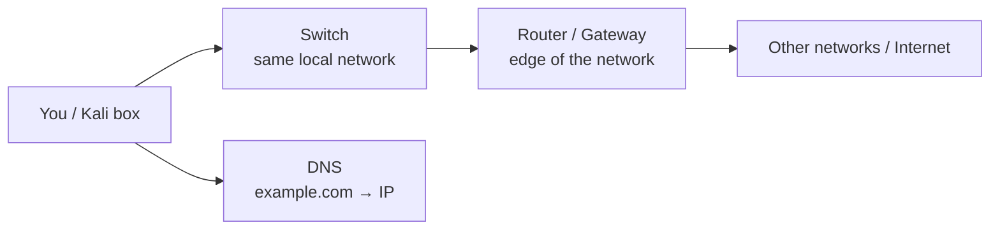
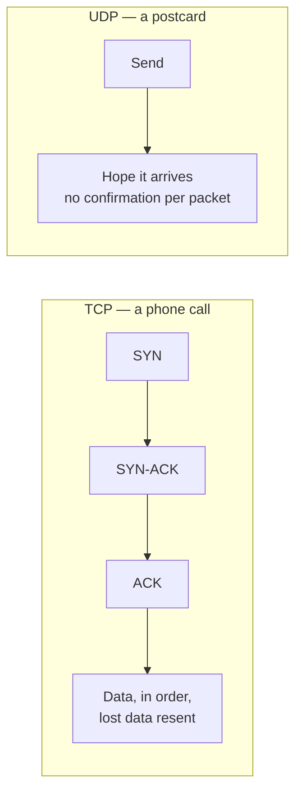
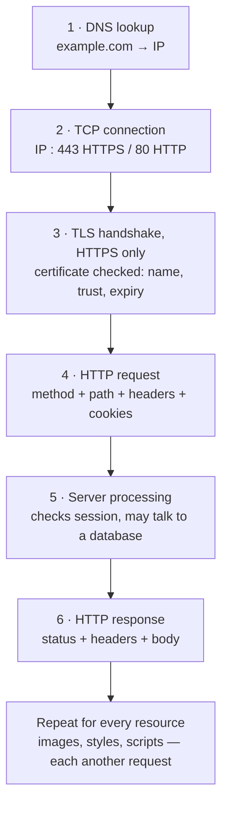
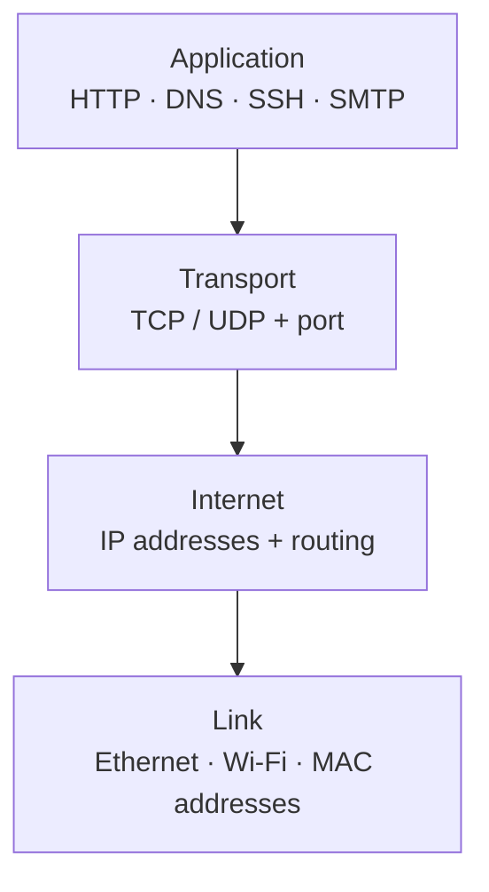
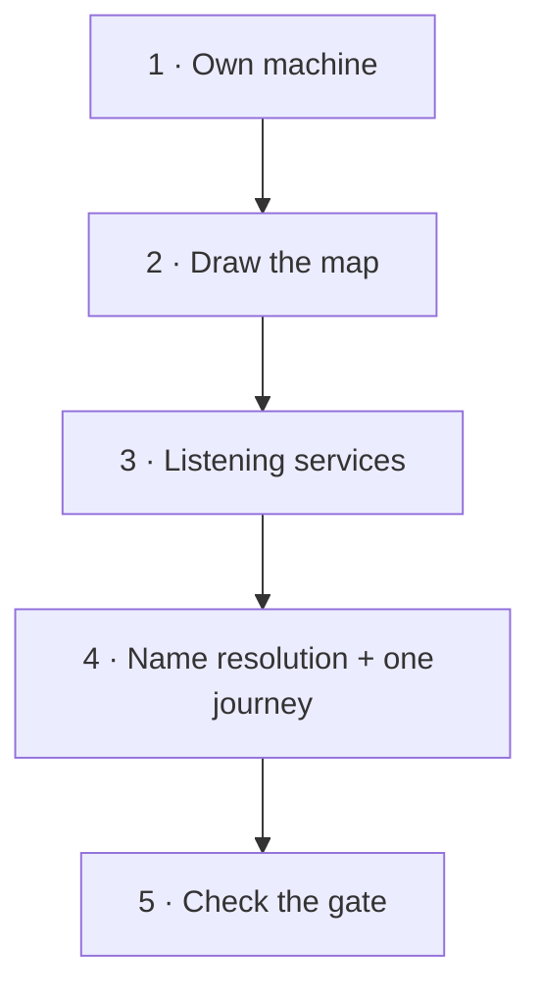

# Network Basics — Visual Notes

Lab only · own machine · own private lab · test data only

## 1. The map, in one picture

A network is a postal system. Keep this picture until it breaks.

| Word | Means, in one line |
|---|---|
| **IP address** | House address — which machine |
| **Port** | Door in that house — which service |
| **Router** | Post office at the edge — between networks |
| **Switch** | Sorter inside the building — inside one network |
| **DNS** | Phone book — name → IP |
| **Packet** | One envelope — data, split and sent one by one |
| **MAC address** | Hardware address on a local link, e.g. `aa:bb:cc:dd:ee:ff` |



Every security question here is the same four:
1. What machines exist in this lab?
2. What doors are open on each?
3. Who is allowed through each door?
4. Which doors should be localhost-only, or closed?

Can't draw it? Draw it before touching a tool.

## 2. IP addresses

| Type | Example | Means |
|---|---|---|
| IPv4 | `192.168.1.10` | Four numbers, 0–255 each |
| IPv6 localhost | `::1` | Same idea as `127.0.0.1`, IPv6 form |
| Localhost | `127.0.0.1` | This machine only — never leaves the box |
| Private | See table below | Inside home / lab / office only |
| Public | On the router's outside | Faces the internet |

| Private range | Usual use |
|---|---|
| `10.0.0.0` – `10.255.255.255` | Large networks and labs |
| `172.16.0.0` – `172.31.255.255` | Medium networks |
| `192.168.0.0` – `192.168.255.255` | Home networks and small labs |

| Address in `ss` output | Means |
|---|---|
| `127.0.0.1:5432` | Localhost only — this machine only |
| `[::1]:5432` | Localhost only, IPv6 |
| `0.0.0.0:5432` | All interfaces — exposed, justify it or close it |

**Subnets, without the maths drill:**

| Notation | Means |
|---|---|
| `192.168.1.10/24` | First 24 bits = network, rest = machines in it |
| `/24` lab | Machines usually share `192.168.1.x`, last number changes |
| Smaller number after `/` | Bigger network, more machines |
| Bigger number after `/` | Smaller network, fewer machines |

What matters: same local network, or a different network reached via the gateway?
That decides whether traffic stays local or goes through the router.

```bash
ip a          # every interface and address — lo = loopback
hostname -I   # short version, one line
```

**Watch out:** a private lab address is still not for public notes — write `<your-lab-ip>` in shared notes.

## 3. Ports — the doors

| Port | Service |
|---|---|
| 21 | FTP — old, plain, insecure by design |
| 22 | SSH |
| 23 | Telnet — old, don't use it for real work |
| 25 | SMTP |
| 53 | DNS |
| 80 | HTTP |
| 110 | POP3 |
| 143 | IMAP |
| 443 | HTTPS |
| 3306 | MySQL |
| 5432 | PostgreSQL |

Rest? Look them up when you meet them. Common ports in memory, everything else in docs.

| Word | Means |
|---|---|
| **Listening** | A service is waiting on that port, on your own machine |
| **Open** | A service answered on that port — present, not automatically vulnerable |
| **Closed** | Machine answered: no service here |
| **Filtered** | No clear answer — usually a firewall dropping the probe silently |

**Port audit — ask for every listening port:**
1. What service is this?
2. Should it be running at all in this lab?
3. Localhost-only, or all interfaces — and why?
4. Is it patched?
5. If not needed, or not meant to be exposed: stop it, bind it to localhost, or firewall it.

## 4. TCP vs UDP



| | TCP | UDP |
|---|---|---|
| Delivery | Every byte, in order, resent if lost | No guarantee, app handles retries if it wants |
| Handshake | Yes — SYN, SYN-ACK, ACK | No |
| Carries | Web, email, SSH, databases | DNS queries, streaming, games, voice |
| Check with | `ss -tln` | `ss -uln` |

Both get the same audit: should this run, should it be exposed?

## 5. DNS, DHCP, and the journey of a web request

| DNS record | Maps |
|---|---|
| A | Name → IPv4 |
| AAAA | Name → IPv6 |
| CNAME | Name → another name (alias) |
| MX | Name → mail server |
| TXT | Text, often ownership verification |

DNS was built for convenience, not security. Wrong answers (spoofing / poisoning) are real — DNSSEC (signed answers) and DNS over HTTPS (encrypted queries) are the defences. Learn normal DNS first, then why those exist.

DHCP, in one line: when a machine joins a network, a server hands it an IP, subnet mask, gateway, and DNS server, for a limited lease. That's why a lab VM usually has a private IP without you typing anything.



**Debug in that order, don't guess:**

| It fails at | Likely cause |
|---|---|
| DNS | Browser can't find the site — DNS problem, not web server problem |
| TCP connection | Server down, port closed / filtered, network broken |
| TLS | Certificate name, trust, or expiry problem — don't click through warnings on real sites |
| HTTP status | Read the status: 200, 404, 403, 500 — different status, different cause |
| Content | Page itself, after the above all passed |

## 6. Layers — TCP/IP first, OSI as reference



| Model | Layers, top to bottom |
|---|---|
| **TCP/IP (use this)** | Application → Transport → Internet → Link |
| **OSI (reference)** | Application → Presentation → Session → Transport → Network → Data Link → Physical |

Learn the idea first, names second, details when a tool forces you to. OSI names show up in docs and Wireshark — keep them as reference, not a memorisation project.

ARP, in one line: on a local network, a machine asks "Who has `192.168.1.10`? Tell me your MAC." Local question, not an internet one.

**Watch out:** MAC addresses can be changed in software on your own lab machine, so MAC alone is weak identity. Don't rely on MAC filtering as a real defence.

## 7. Firewall, NAT, VPN

| Tool | Job, in one line | Default to aim for |
|---|---|---|
| **Firewall** | Gate with rules: what is allowed in, out, or blocked | Default-deny — block everything, allow one thing at a time, with a note saying why |
| **NAT** | Many private machines share one public IP; router rewrites addresses out and back | On by default in a lab — but NAT alone is not a firewall |
| **VPN** | Encrypted tunnel to another network across the internet | Only when a trusted lab platform requires it |

Forwarding a port makes it reachable from outside on purpose. That must be deliberate and checked, never accidental. A vulnerable lab VM never sits directly on the internet.

## 8. Size up a new lab network — in order



| # | Check | How, own machine / lab only |
|---|---|---|
| 1 | Own machine | `ip a` · `hostname -I` — private IP, interfaces, localhost |
| 2 | Draw the map | Boxes per machine + gateway, lines for connections, IPs on boxes, traffic notes |
| 3 | Listening services | `ss -tln` — port audit from §3 for each port |
| 4 | Names + journey | `dig` for a lab name, then trace one web request through §5, step by step |
| 5 | The gate | What's allowed in / out / blocked by default? Any lab service forwarded outside? |

## 9. Lab pass — try it now

```bash
ip a
hostname -I
ss -tln
ss -uln
```

Write down: interfaces, private IP (as `<your-lab-ip>` in shared notes), localhost, and each listening port with a localhost-only vs exposed note. Draw the lab network on paper — boxes, IPs, ports. Then explain it out loud, without notes, in three minutes: how many machines, what IPs, what services are listening and why, and the path a web request takes.

Anything you can't explain goes back to the start. That explanation is the real test.

**Watch out:**
- An open port is not automatically a vulnerability — it's a service, and the questions after it decide whether it's a finding.
- Localhost-only is not "no service" — it's a service deliberately reachable only from the same machine, which for databases and internal services is usually good design. Check whether it's intentional.

Next → `network-tools.md`

---
*Lab only: systems you own or have written permission to test, test data only.*
