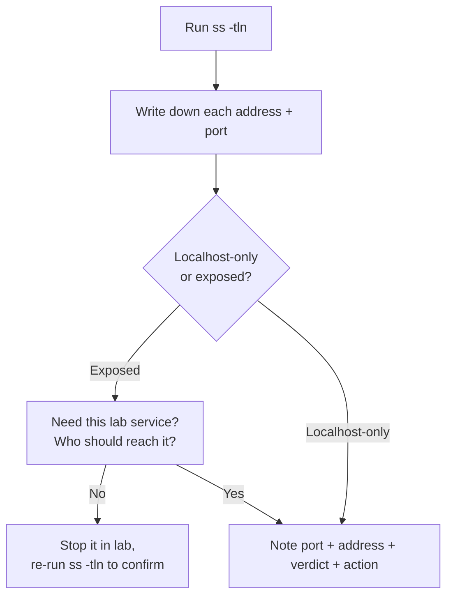
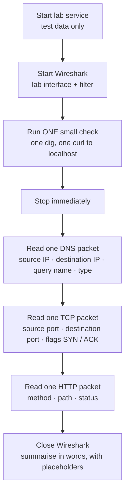

# Network Tools — Visual Notes

Lab only · own machine · own private lab · small single checks only

## 1. Question first, tool second

A tool gives evidence for a question, not an answer. Every check, same shape:


| Question | Tool |
|---|---|
| What is my own IP? | `ip a` |
| What's listening on my own machine? | `ss -tln` |
| Is my own machine reachable from itself? | `ping -c 2 127.0.0.1` |
| What does DNS say for this lab name? | `dig <lab-name> +short` |
| What does my lab web service return? | `curl -i http://127.0.0.1:<lab-port>/` |
| What do the packets actually look like? | Wireshark, lab only, with a filter |

One check at a time. Not a sweep, not a flood, not a loop.

## 2. `ip` — your own network identity

Read-only forms for learning: `ip a`, `ip link`, `ip route`. Run at the start of a lab session, after joining a lab network, or when a lab service doesn't respond.

```bash
ip a
ip link
ip route
ip a show lo
```

| Output line | Means |
|---|---|
| `2: eth0:` | Interface number and name — `eth0` usually wired, `wlan0` usually wireless |
| `UP, LOWER_UP` | Interface up, link present — `DOWN` means off |
| `mtu 1500` | Maximum packet size — leave it alone |
| `inet 192.168.1.10/24` | IPv4 address + subnet, private lab address in this example |
| `brd 192.168.1.255` | Broadcast address for that subnet |
| `scope global` | Usable on that network — `scope host` on `lo` = localhost only |
| `default via 192.168.1.1 dev eth0` | To reach outside, send packets to gateway `192.168.1.1` via `eth0` |

On `lo` you should see `127.0.0.1/8` and `::1/128` — your machine talking to itself, always present, even with no cable.

**Watch out:** interface name is not an IP (`eth0` is not an address), and a private IP is not your public IP. In notes, write `<your-lab-ip>`, not the real value.

## 3. `ss` — what's listening on your own machine

```bash
ss -tln
ss -tlnp
```

| Flag | Means |
|---|---|
| `-t` | TCP only |
| `-l` | Listening only |
| `-n` | Numbers, not names — no DNS lookups, ports shown clearly |
| `-p` | Process behind the port, if you have permission in your lab |

```
State  Recv-Q  Send-Q  Local Address:Port  Peer Address:Port
LISTEN 0       4096    127.0.0.1:5432     0.0.0.0:*
LISTEN 0       4096    [::1]:5432         [::]:*
```

| Address | Means |
|---|---|
| `127.0.0.1:5432` | Localhost-only IPv4 — safer |
| `[::1]:5432` | Localhost-only IPv6 — same idea |
| `0.0.0.0:5432` | All IPv4 interfaces — exposed, check why, and whether it needs to be |



`ss` shows only your own machine — never remote ports. That's a feature for this kind of audit. A LISTEN line is not evidence of an attack; it just means a service is waiting.

## 4. `ping` — is one lab host reachable

```bash
ping -c 2 127.0.0.1
```

```
64 bytes from 127.0.0.1: icmp_seq=1 ttl=64 time=0.045 ms
64 bytes from 127.0.0.1: icmp_seq=2 ttl=64 time=0.038 ms
2 packets transmitted, 2 received, 0% packet loss
```

| Part | Means |
|---|---|
| `64 bytes from` | One reply |
| `icmp_seq` | Reply sequence number |
| `ttl=64` | Time-to-live remaining — drops by one per router hop; high on localhost is normal |
| `time=0.045 ms` | Round-trip — localhost very fast, same-network lab VM usually a few ms |
| `0% packet loss` | All replies came back |

| Result | Proves | Does NOT prove |
|---|---|---|
| Reply | Host reachable via ICMP | A web service runs, a port is open, or a host is safe |
| `100% packet loss` | ICMP replies didn't come back | Host is down — many firewalls block ICMP by design |

Always use `-c 2` or `-c 4`. A `ping` without a count runs forever.

## 5. `dig` and `nslookup` — what does DNS say

One query at a time. `dig example.com +short` is a public learning example, not a target to probe.

```bash
dig example.com +short
dig example.com A
nslookup example.com
```

| `dig` section | Means |
|---|---|
| QUESTION | What you asked — name, type |
| ANSWER | What DNS returned — name, TTL, type, value |
| AUTHORITY | Authoritative nameserver |
| ADDITIONAL | Extras, e.g. the nameserver's own IP |
| `status: NOERROR` | Success |
| `status: NXDOMAIN` | Name doesn't exist |
| `status: SERVFAIL` | Server failed to answer |
| `Query time` | How long it took — first query slower, cached faster |
| `SERVER` | Which DNS server answered, often your router or lab DNS |

| Record | Means |
|---|---|
| A | IPv4 |
| AAAA | IPv6 |
| CNAME | Alias to another name |
| MX | Mail server |
| TXT | Text, often verification |
| NS | Nameserver |

**Watch out:** a cached answer is not always fresh — TTL says how long it may be cached. And a DNS answer proves nothing about whether the website is up. Check DNS and the service separately.

## 6. `traceroute` and `arp` — path and neighbours

| Tool | Question it answers |
|---|---|
| `traceroute` (Linux) / `tracert` (Windows) | Where does a packet stop on the way to one destination? |
| `ip neigh` / `arp -a` | Which IPs on my local network map to which MACs, on my own machine? |

```bash
ip neigh
arp -a
```

```
192.168.1.1 dev eth0 lladdr aa:bb:cc:dd:ee:ff REACHABLE
```

| State | Means |
|---|---|
| REACHABLE | Entry is fresh |
| STALE | Old, re-checked on next use |
| FAILED | Couldn't be reached |

| `traceroute` line | Means |
|---|---|
| A hop with a time | That router replied |
| `* * *` | That hop didn't reply to that probe — often ICMP blocked, not a broken path |
| Next hop still replies | Path continues — `* * *` alone does not mean the network is down |

Hops shown are logical, not physical, and can change between runs. ARP only works on the same local subnet — across routers, the gateway's MAC is used instead.

## 7. `curl` — what does a lab web service actually return

Only against your own lab service, or a service you have written permission to test.

```bash
curl -i http://127.0.0.1:8000/
```

```
HTTP/1.1 200 OK
Content-Type: text/html
Content-Length: 123

<html>...</html>
```

| Part | Means |
|---|---|
| `HTTP/1.1 200 OK` | Protocol, status code, reason — 200 = success |
| `Content-Type: text/html` | Body is HTML — also meet `application/json`, `text/plain` |
| `Content-Length: 123` | Body size in bytes |
| Blank line | Headers end, body starts |

| Status | Means |
|---|---|
| 301 / 302 | Redirect — go to another URL |
| 404 | Not found — that path doesn't exist on the service |
| 403 | Forbidden — not allowed to see it |
| 500 | Server error — service failed internally |

A page coming back proves the service responded. It does not prove the service is secure.

**Watch out:** never send real passwords, tokens, or data with `curl` in a public note or screenshot — test data only, placeholders like `<test-password>`. Never download a script from the internet and run it blind — read it first, always.

## 8. Wireshark — what packets actually look like

Packet analyser: captures packets on an interface in your own lab and shows them decoded, layer by layer — Ethernet, IP, TCP/UDP, HTTP, DNS. `ping`, `dig`, and `curl` give summaries; Wireshark shows the actual packets behind them.



| Filter | Shows only |
|---|---|
| `dns` | DNS only |
| `http` | HTTP only |
| `ip.addr == <your-lab-ip>` | One lab host |
| `tcp.port == <lab-port>` | One lab port |

Constraints, no exceptions: own private lab only, your own machines only, never a shared / school / company / public network, never other people's traffic, never passwords or tokens even in lab. Don't save or publish captures with real data.

| Wireshark does | Wireshark does NOT do |
|---|---|
| Show packets you're allowed to capture | Hack a network |
| Show TLS handshake packets | Decrypt HTTPS by magic — no plaintext bodies without your own advanced lab keys |
| Show what packets looked like in that capture | Prove a network is secure |

**Watch out:** capturing without a filter on a busy network drowns you in packets. Filter first.

## 9. One audit of your own machine — in order

| # | Step | Command / check |
|---|---|---|
| 1 | Own setup | `ip a` — interface, private IP as `<your-lab-ip>`; `ip route` — gateway |
| 2 | Listening ports | `ss -tln` — each port: localhost-only or exposed? Exposed + unneeded → stop it in lab |
| 3 | Reachability | `ping -c 2 127.0.0.1` — confirm 0% loss for localhost |
| 4 | DNS | One `dig` for a lab name, or `dig example.com +short` as a learning example |
| 5 | Web service | If you have one: `curl -i` once — status code + content type |
| 6 | Neighbours | `ip neigh` — gateway + state |
| 7 | Optional packets | One small filtered Wireshark capture in lab, then stop |
| 8 | Clean up | Stop lab services you don't need, close Wireshark, check no real IPs / hostnames / passwords in shareable notes |

| Localhost vs exposed — the one table to remember | |
|---|---|
| `127.0.0.1` / `::1` | This machine only |
| `0.0.0.0` / `::` | All interfaces — exposed to the network |

A good audit is boring in the best way: small checks, clear notes, no surprises — always with written permission, in a lab or an authorised scope, never on other people's networks.

Next → `web-basics.md`

---
*All examples are for your own machine or your own private lab only. Test data only.*
