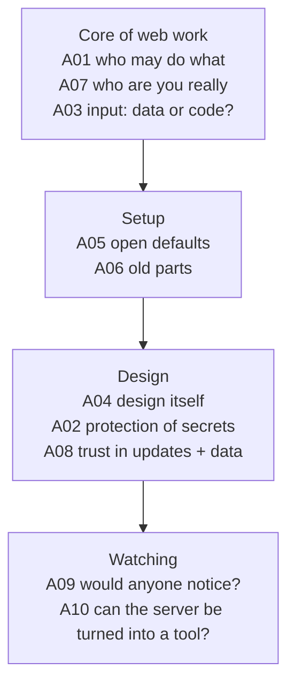
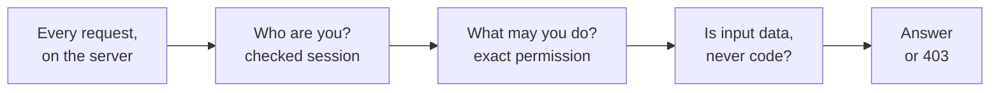

# OWASP Top 10 — Visual Notes

Defence map, not a list to try. 2021 list — the one most courses, labs, and job descriptions still refer to. Names may move in a newer list; the mistakes stay the same.

Lab only · apps you built yourself, or a deliberately vulnerable lab app on your own machine · never a real website, school, or company system without written permission · placeholders only: `your-user`, `<test-password>`, `<example-session-value>`

For each risk, ask: what is the mistake? What does the server fail to check? What would a safe design check instead?

## 1. The list at a glance

| Code | Risk | In one line |
|---|---|---|
| A01 | Broken Access Control | Server lets you do or see things you shouldn't |
| A02 | Cryptographic Failures | Secrets and data aren't protected properly |
| A03 | Injection | Untrusted input is treated as a command, not as data |
| A04 | Insecure Design | Design itself has no safety rules from the start |
| A05 | Security Misconfiguration | Setup left open, default, or leaking detail |
| A06 | Vulnerable and Outdated Components | Old, known-broken parts still used |
| A07 | Identification and Authentication Failures | Login and identity checks are weak |
| A08 | Software and Data Integrity Failures | Updates and data trusted without checking |
| A09 | Security Logging and Monitoring Failures | Attacks happen and nobody notices |
| A10 | Server-Side Request Forgery (SSRF) | Server tricked into making asks for you |

## 2. All ten, one row each

| Code + risk | Meaning | Lab defence idea | Mistake to avoid |
|---|---|---|---|
| **A01 Broken Access Control** | Hotel giving every guest a master key: page hides a button, but server never checks permission when the request arrives; or server trusts `?user_id=42` without checking the logged-in user really is user 42 | Server-side check for every request: who is this, from the checked session? What are they asking for? Allowed that exact thing? If no, answer `403 Forbidden` | "Nobody will guess this URL" — URLs are guessed, shared, logged, found |
| **A02 Cryptographic Failures** | Secret on a postcard, or safe with the key taped to it: sensitive data over plain HTTP; passwords in plain text, or weak / fast / reversible storage; old broken encryption; hard-coded or never-changed keys | HTTPS for any real network traffic; passwords only as hashes from a proper password-hashing method, never plain text, never in a shareable file; secrets out of code and public files | "We use encryption" — which method, which key, where does the key live, protected in travel and in storage? |
| **A03 Injection** | Search box / form / URL value joined directly into a database query, system command, or page — input changes what the query or command means. Classic form: SQL injection | Parameterised queries (prepared statements): query shape fixed first, input sent separately, only as a value, can never change the shape. Check input (type, length, allowed characters) too, but checking alone isn't enough. Encode data shown back in a page so the browser treats it as text, not page code | "Blocking bad words" — block one word, a lab attacker uses another spelling |
| **A04 Insecure Design** | Bank built with no vault, then made "safe" by a stronger front door: no threats written down before building — who may do what, what must never leak, what happens after too many failed logins, what happens when a session ends. Works in normal use, breaks under misuse | Before building a lab feature, write three lines: inputs (what can arrive, from whom?) · trusted parts (what must the server check before it acts?) · failure points (what happens if input is wrong, missing, or hostile?). Build the checks first, then the feature | Adding safety at the end, as an afterthought — no single fix later can make a missing design safe |
| **A05 Security Misconfiguration** | Moving into a new house, leaving the builder's default lock code, spare key under the mat, and a sign listing every room: defaults unchanged (defaults are public knowledge); error pages showing database errors, file paths, versions, stack traces; sample pages and test accounts left enabled; security headers missing | Setup note for every lab server: change all defaults · remove sample pages and test accounts you don't need · short, safe error to users, full detail in a private log only · close doors you don't use | Dismissing it as "not a real bug" because the code works — an open default or leaking error page is often the first door walked through |
| **A06 Vulnerable and Outdated Components** | House with locks everyone already knows how to open: a library used once, never checked again; a known flaw + published fix, app still on the old version; no list of what the app uses, so nobody knows what needs updating | Per lab project, keep a list: component name, version, where you got it. Check against update notes, update in your own lab first, test the app still works, one component at a time so a break points at one change | "It works now, don't update" — the app falls further behind, and updating later gets harder and riskier |
| **A07 Identification and Authentication Failures** | Club checking IDs badly: accepts a photo of an ID, lets you in with someone else's ticket, never takes the ticket back. Short passwords allowed, no limit on login tries, same session kept after login, session IDs short / guessable / never expiring, logout only hides the page, errors saying which part was wrong ("username does not exist") | Fresh, long, random session ID after login, old one dropped · limit login tries, slow repeated failures · same safe error whatever failed — "Username or password is incorrect", never which part · sessions expire, logout deletes the session on the server · passwords only as proper hashes | Error messages or reset flows that leak who has an account, or accept a weak, guessable reset value |
| **A08 Software and Data Integrity Failures** | Accepting a delivery box without checking sender, seal, or swapped contents, then installing it on trust: updates / libraries / plugins downloaded and run without signature, hash, or trusted source; signed values, stored settings, uploaded files accepted without checking who made them or whether they changed | Get lab software only from its official source, check its signature or hash when the project gives one, note what you installed and where it came from. Treat anything from outside your own lab as untrusted until its source is checked — same rule as input in A03, applied to software and data | Trusting a build or deployment step that runs code from an untrusted place — one changed part can change the whole app |
| **A09 Security Logging and Monitoring Failures** | Shop with no cameras and no alarm log: someone tries the door every night, nobody knows. Failed logins, 403s, strange inputs, errors not logged, or logged only on the user's screen. Logs exist but never read, or so noisy a real attack hides. Or logs store secrets, becoming a leak of their own | Log important events on the server, in your own lab, without secrets: time · what was asked for · who the session claimed to be · result (success, 401, 403, 404). Then actually read the log and ask whether anything looks like repeated tries. Start with logins, permission denials, errors | A log nobody reads is decoration, not defence — and never put passwords, session values, or personal data in a log line |
| **A10 Server-Side Request Forgery (SSRF)** | Asking a hotel receptionist to "fetch something from the back office": receptionist can enter it, you can't, and never checks what you asked for. App takes a URL from a user request and the server itself fetches it — image, link check, another service — without checking where it really points. That URL may point to an internal address, like a localhost service, the user could never reach directly, and the server's answer leaks what it said | Never let a user-supplied URL decide where the server fetches from without a strict check. Allow only a small, written list of hosts and schemes the feature truly needs. Resolve the host yourself, reject it if it resolves to a private / localhost / link-local address, unless that internal call is deliberate. Never return the raw internal response — only the safe, checked result | Checking only the text of the URL, not where it really points — a name can resolve to an internal address, and a redirect can move a request from a safe place to an internal one |

## 3. Study order — each step builds on the last

## 4. Lab pass — one mistake, one fix, one note

Build a tiny lab web app of your own: a login, a session, one or two pages. Then, only in that lab, make one design mistake at a time, see what breaks, and fix it with the defence idea above. One mistake, one fix, one note.

| Step | Do |
|---|---|
| 1 | Build the lab app clean: login, session, checked permissions, parameterised queries |
| 2 | Break one thing only — e.g. remove one permission check |
| 3 | Note what changed: who can now do what that they shouldn't? |
| 4 | Fix it with the defence in §2, re-test, write the note |
| 5 | Repeat for the next risk — never two breaks at once |

That's how the Top 10 becomes skill instead of a list you once read.

One line to carry forward: most web risk is not magic — it's a server that failed to check who you are, what you may do, or whether input is data or code, and a safe design checks all three, on the server, for every request.

---
*Educational use only. All practice on systems you own or have written permission to test.*
