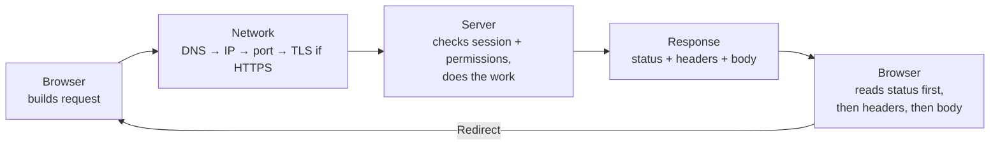
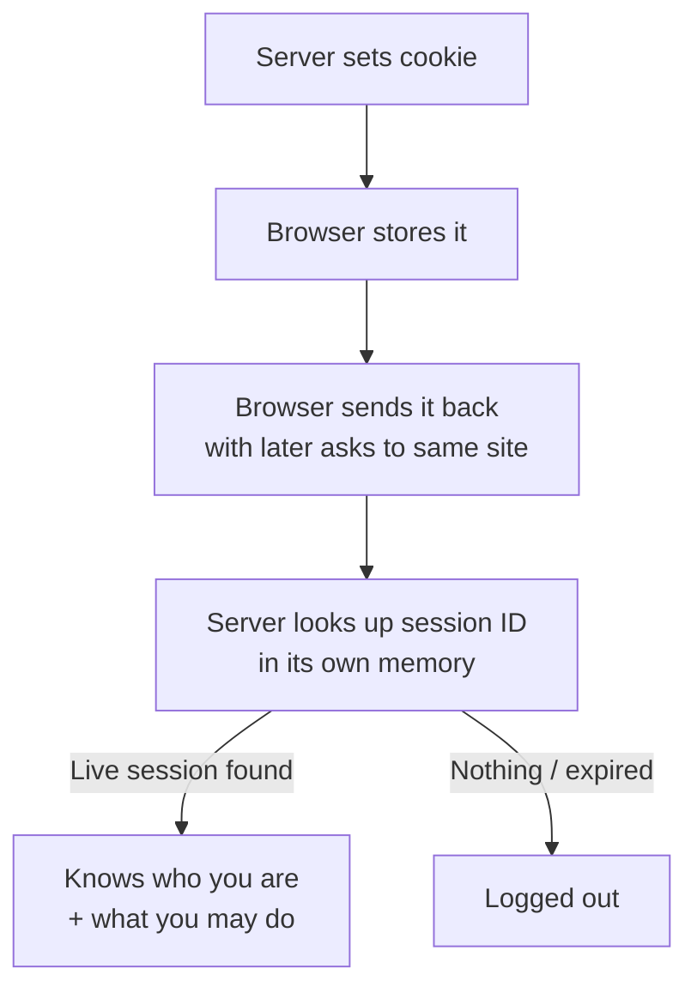
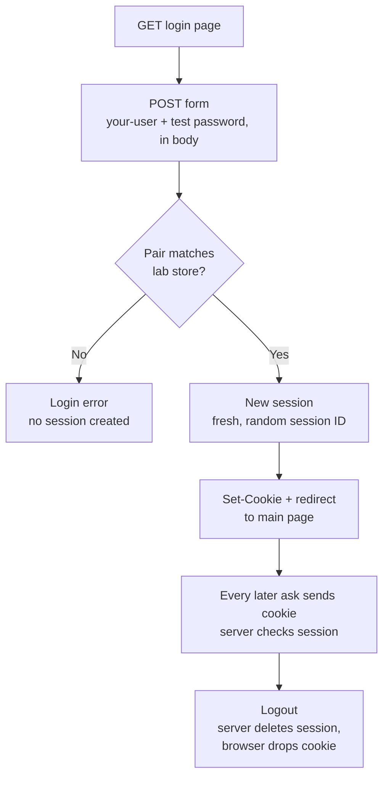

# Web Basics — Visual Notes

Lab only · own machine · own private lab · `http://127.0.0.1:8000` and `example.com` as examples

## 1. The picture

| Part | Job |
|---|---|
| **Browser** | Customer — asks, shows the answer, remembers small notes |
| **Server** | Kitchen — program on a computer, listening on a port, prepares the answer |
| **Website** | Menu + kitchen rules — what you can order, what's checked before cooking |
| **Network** | Road between customer and kitchen — IPs, ports, DNS, packets |
| **HTTP** | Language of the order |

Every web security question starts with four asks: who is asking? What exactly are they asking for? What does the server check before it answers? What does it send back, to whom?

## 2. Reading a URL

```
https://example.com:443/shop/item?id=42#details
```

| Part | Example | Means |
|---|---|---|
| Scheme | `https` | Which rules to use |
| Host | `example.com` | Which server, by name — DNS turns it into an IP |
| Port | `:443` | Which door — often hidden when it's the default |
| Path | `/shop/item` | Which thing on that server |
| Query | `?id=42` | Extra details — `name=value` pairs joined by `&`, e.g. `?id=42&sort=price` |
| Fragment | `#details` | Which part of the page to jump to — browser only, never sent to the server |

Read it out loud: `http://127.0.0.1:8000/notes?page=2` = "On this computer, door 8000, show me notes, page 2."

**Watch out:** query strings end up in browser history and server logs — never put a password or token in a URL.

## 3. HTTP — request, then response



| Request part | Means |
|---|---|
| Method | What kind of action |
| Path | Thing being asked about, from the URL |
| Headers | Extra notes about the ask |
| Body | Data itself — mainly POST / PUT / PATCH; a GET normally has no body |

| Method | Means |
|---|---|
| GET | Show me this — should not change anything on the server |
| POST | Take this data and do something — forms, logins, creating things |
| PUT | Replace a thing |
| PATCH | Change part of a thing |
| DELETE | Remove a thing |
| HEAD | GET, headers only |
| OPTIONS | Ask what a thing allows |

A GET, written out:

```
GET /notes?page=2 HTTP/1.1
Host: example.com
User-Agent: example-browser
Accept: text/html
```

A response, written out:

```
HTTP/1.1 200 OK
Content-Type: text/html
Content-Length: 48

<html><body><h1>Notes, page 2</h1></body></html>
```

| Response part | Means |
|---|---|
| Status line | Protocol + status code + reason |
| Headers | Notes about the answer |
| Blank line | Headers end here |
| Body | Actual content |

## 4. Status codes — learn the groups, then the common ones

| Group | Means | Common codes |
|---|---|---|
| 2xx | Success | 200 OK · 201 Created · 204 No Content |
| 3xx | Redirect — "not here, go there" | 301 moved permanently · 302 moved for now · 304 not modified, use cached copy |
| 4xx | Ask was wrong somehow | 400 bad request · 401 unauthorised · 403 forbidden · 404 not found · 429 too many requests |
| 5xx | Server failed while trying | 500 internal error · 502 bad gateway · 503 unavailable for now |

| Code | Means — don't mix these up |
|---|---|
| **401** | "Who are you? Log in first." — not authenticated yet (name is confusing) |
| **403** | "I know who you are. Still no." — authenticated, not permitted |

## 5. Headers — notes on the envelope

Headers are `Name: value` lines — notes about the data, the asker, and the rules. Not the data itself.

| Header | Means |
|---|---|
| Host | Which server name the ask is for — one server can host many names |
| User-Agent | Which browser or tool is asking — never trust it as identity |
| Accept | What kind of answer the asker can handle — HTML, JSON, image |
| Content-Type | What kind of data is in the body — `text/html`, `application/json`, form-encoded |
| Content-Length | Body size in bytes |
| Cookie / Set-Cookie | Memory mechanism — see §6 |
| Authorization | Proof of who you are, e.g. a token — lab placeholders only |
| Location | Where to go next on a redirect |
| Cache-Control | Rules about saving a copy and reusing it |

Lesson: never trust a header as proof by itself. User-Agent can say anything, cookie values can be copied. Trust comes from a checked session on the server. Content-Type is only a label the sender wrote — the server still checks the data itself.

## 6. Cookies and sessions — how the web remembers you

HTTP alone has no memory. Every request is a new stranger. Cookies + sessions fix that.



Coat-check ticket: shop gives you a ticket, you show it each time, shop knows which coat is yours.

```
Set-Cookie: session_id=<example-session-value>; Path=/; HttpOnly
Cookie: session_id=<example-session-value>
```

| Cookie rule | Means |
|---|---|
| HttpOnly | JavaScript in the page cannot read the cookie |
| Secure | Send only over HTTPS, never plain HTTP |
| SameSite | Limits sends with asks from another site — stops other sites riding your logged-in state |
| Path / Expires / Max-Age | Where it applies, and how long the browser keeps it |

| Cookie vs session | |
|---|---|
| **Cookie** | Lives in the browser — usually holds only a random session ID, a ticket number |
| **Session** | Lives on the server — the real record: who is logged in, what they're allowed, when it ends |

**A lab login, in order:**



Design rules for your own lab apps:

| Rule | Why |
|---|---|
| Session ID long, random, unguessable, changed after login | A short / guessable / unchanged ID can be copied or guessed in lab |
| Store only a random ID in the cookie, record on the server | Cookie lives in the browser and can be copied — never a user record or password in it |
| Sessions expire; logout deletes the session on the server | A session that never expires is a key that never stops working; hiding the page is not logging out |
| Check every cookie value on the server | If the server believes any cookie, anyone can write their own and claim to be anyone |

## 7. HTTPS — the sealed envelope

| Plain HTTP | HTTPS (HTTP inside TLS) |
|---|---|
| Readable text — anyone seeing traffic can read it | Encrypted — only browser and server can read it |
| No server identity check | Authentication — certificate checked against the URL host |
| Changes on the way go unnoticed | Integrity — changed data fails the check |

Flow: browser asks for a secure connection → server shows its certificate → browser checks host match + trusted authority → both agree secret keys for this visit → all HTTP travels inside that channel. Same HTTP rules inside — just in private.

**Watch out:** HTTPS protects data on the road, not the app itself. Perfect HTTPS + broken login, broken access control, or injection is still broken — see `owasp-simple.md`. On your own machine, `http://127.0.0.1:8000` is safe for learning because traffic never leaves your computer. Elsewhere, prefer HTTPS, never send a real password over plain HTTP.

## 8. Forms, JSON, APIs

| Shape | Example | Notes |
|---|---|---|
| Form POST | `username=your-user&password=<test-password>` in the body, form-encoded | Fields become `name=value&name=value` |
| JSON | `{"username": "your-user", "page": 2, "notes": ["first note", "second note"]}` | Names in double quotes; values: text, numbers, true / false, null, `[]`, `{}` |
| API | `GET /api/notes?page=2` returns JSON | Same data as `GET /notes?page=2` (HTML), different shape, different audience |

JSON is data, not code — a good server treats it as data and never runs it as code.

Page calling an API: HTML loads → JavaScript calls the API with `fetch` → server checks the session, answers status + JSON → code reads status first (2xx: read JSON; 4xx / 5xx: safe error, not raw server detail) → page updates only the part that changed.

## 9. How a page loads, end to end

1. Browser splits the URL — scheme, host, port, path, query, fragment.
2. DNS turns the host into an IP, unless it's already `127.0.0.1`.
3. Browser connects on that IP and port, TLS first for HTTPS.
4. Browser sends the HTTP request — method, path, headers, cookies, body if any.
5. Server checks session and permissions, does the work, sends status, headers, body.
6. Redirect? Browser goes back to step 1 with the new location.
7. Browser reads HTML, then asks for images, styles, scripts — each another request. JavaScript may call APIs — each another request.
8. Browser shows the finished page, keeps cookies for the next visit.

One "page" is really many requests. A slow or broken page is often one slow or broken request among many — read them one by one, in order.

## 10. Lab pass — a web server on your own machine only

```bash
mkdir -p ~/web-lab
cd ~/web-lab
echo "<h1>Hello from my own machine</h1>" > index.html
python3 -m http.server 8000 --bind 127.0.0.1
```

Leave that terminal open while you test — it serves only files in `~/web-lab`, only to your own computer. In a second terminal:

```bash
curl -i http://127.0.0.1:8000/
curl -i http://127.0.0.1:8000/no-such-page
```

| Ask | Expect |
|---|---|
| `/` | `200 OK`, Content-Type + Content-Length headers, blank line, your `<h1>` body |
| `/no-such-page` | `404 Not Found` — same server, same steps, different status, because the path doesn't exist |

Stop the server with `Ctrl+C` when you're done — a lab server left running is a door left open, even on localhost.

**Watch out:** without `--bind 127.0.0.1` it listens on every interface, not localhost only. Serve only a small lab folder you made for the lesson — never a folder holding real personal files.

Next → `owasp-simple.md`

---
*Lab only: systems you own or have written permission to test, test data only.*
