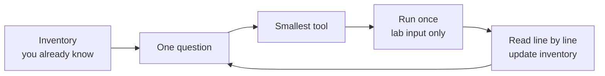
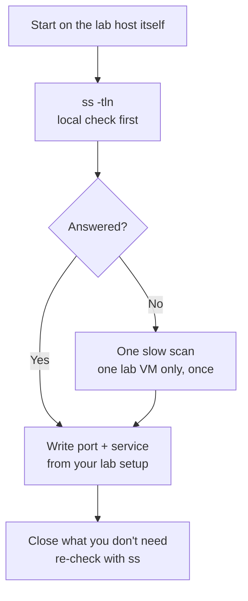

# Recon Tools — Visual Notes

Lab only · lab domains / VMs you created yourself · placeholders only

Recon = information gathering before you test anything: what names, addresses, and services exist in your lab. It is asking, small and careful: what is here, in a lab I already own?

## 1. The rhythm — one question, one run



Good recon is boring in a good way: small checks, clear notes, no surprises. Bad recon is a flood of queries and a pile of output with no question behind it. Recon shows up in logs, so keep it minimal, authorised, and documented. One host, one name, one query, slowly.

A good note, short:

```text
Lab: my own lab network, date: <date>
Question: What DNS records does my lab domain have?
Tool: dig, one query — Input: <lab-domain>
Meaning: A record -> <your-lab-ip>, MX record -> <lab-mail-host>
Inventory: lab domain -> lab IP, lab mail host
Next: Is the lab web service listening there?
Personal data: none
```

A bad note is long, unedited output with real IPs, no question, no meaning, no next step — and if shared, it leaks.

## 2. DNS recon — what does DNS say about my lab name?

Use `dig` one name at a time, for a lab domain you created yourself. No lab domain yet? `example.com` works for one learning query — not as a target.

```bash
dig <lab-domain> +short
dig <lab-domain> A
dig <lab-domain> MX
```

| Record | Means | Trap |
|---|---|---|
| A / AAAA | IPv4 / IPv6 address for that name, in lab | Doesn't prove a service is running |
| MX | Mail server for that lab domain, if set up | — |
| CNAME | One lab name is an alias for another | Follow it, don't assume |
| TXT | Text, often used for verification in lab | Text only, not a verdict |
| NXDOMAIN | DNS has no record for that name | Does **not** mean the host is down |
| NOERROR, no answer | DNS worked, no record of that type | Not a DNS failure |

DNS only gives an address — the service can still be down. Enumerating subdomains of a real domain to "find hidden things" is enumeration, and needs written permission.

## 3. WHOIS — a management tool, not an investigation tool

WHOIS is the public record for registrations: who registered a domain, when, which nameservers it uses. Most records today are redacted.

| Use it for | Don't use it for |
|---|---|
| Your own lab domain: registration date, expiry, nameservers | Investigating other people |
| Managing your own lab, in private lab notes | Targeting a person, employee, or company |

No command to run here on a real domain. For your own lab domain, check your own registrar dashboard — and keep it in private notes, not a public file. "Public" does not mean "free to use for any purpose."

## 4. Service identification in lab — what runs on my lab host?



`ss` on the host itself is the safest check and often answers the question with no scan at all. Only if you still need a remote check, run one slow, lab-only scan against that one lab VM, then stop.

| Scan says | Means | Doesn't mean |
|---|---|---|
| Open | That lab port responded, in that scan, at that time | The service is vulnerable |
| Closed | It did not respond with a service, in that scan | Read it as that scan only |
| Filtered | A firewall in lab dropped the probe, so no reply | Not closed, not hidden-for-security — dropped |

For each open port, write the port, the service name from your lab setup (not a guess), and whether it should be open. A scan's service name is a guess from port and banner — confirm it from your lab setup.

**Watch out:** scanning a whole subnet "to see what is there" instead of checking your inventory list — your list is faster, quieter, more accurate. An open port is a door, not a vulnerability: the problem depends on the service, who should reach it, and how it is configured.

## 5. Subdomains and directories in lab — inventory, don't enumerate

For a lab site you built yourself, don't guess URLs — list what you actually made:

1. List, from your lab project folder, the pages and directories you created.
2. Compare that list to what your lab web server actually serves.
3. Extra, sample, or backup pages you didn't intend to serve? Remove or disable them, and re-check.
4. Note what you removed and why, placeholders only.

Inventory-first teaches the same lesson as enumeration — forgotten test pages and backup files are a classic misconfiguration — without probing a real target. Guessing URLs on a real site still needs written permission first.

## 6. OSINT, with care

OSINT = information gathered from public sources: websites, documents, social media, code.

| Safe, encouraged | Not learning — don't do it |
|---|---|
| Public docs for a tool you use | Gathering data about a real person or company to target them |
| Public guidance from OWASP | Collecting personal data like addresses or phone numbers |
| Public lab write-ups from people who tested their own labs | Planning social engineering |

"Public" on its own doesn't make gathering and acting on personal information about a real person harmless. Keep OSINT to tools, concepts, and lab systems — never a report about a real person or company.

## 7. Lab pass — try it now

```bash
dig example.com +short   # one public learning query, not a target
ss -tln                  # what listens on your own machine, first
```

Write one recon note: lab, question, tool, input (placeholder), meaning, inventory update, next question, personal data: none. One query, one note, is the whole habit.

**Done when you can:** one question, one tool, one run, inventory updated — without sweeping anything.

Next → `web-tools.md`

---
*Lab only: systems you own or have written permission to test, test data only. Never publish a real domain, real IP, real username, or real personal data.*
