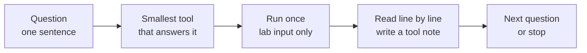
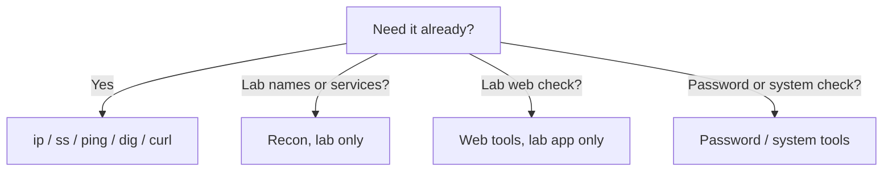

# Tools Overview — Visual Notes

Lab only · own machine / own private lab · test data only

## 1. Question first, tool second



A tester knows, for each tool: question, input, output, meaning, limit, next check. A tool-runner only knows its name.

```text
Question: What is listening on my own machine?
Tool: ss — Command: ss -tln
Meaning: LISTEN = a service is waiting.
  127.0.0.1 = localhost only. 0.0.0.0 = exposed to the network.
Limit: this says nothing about a remote host.
```

## 2. The five families

| Family | Question it answers | Start with |
|---|---|---|
| System + network checks | What is on my machine, what is listening, what is my network? | `ip`, `ss`, `ping`, `dig`, `curl`, `ps`, `ls` |
| Recon, lab only | What is known about a lab target I own? | DNS tools, WHOIS idea, lab listing |
| Scanning, lab only | Which ports are open on a lab host I own? | Port scanner, one lab VM, slowly |
| Web tools, lab only | How does this lab site work, and where is the design weak? | Dev tools, `curl`, lab proxy, lab scanner |
| Password, system, reporting | Is this lab password weak? Is this lab system safe? | Test-password checkers, own-machine audits |

Use the first family first, every time — local, mostly read-only, settles half your questions.



**Watch out:** biggest tool first = floods of output, nothing learned, and on a real system, unauthorised testing.

## 3. Learning a new tool, properly
1. Read its own help: `tool --help` or `man tool`, on your own machine.
2. Write its question in one sentence.
3. Find one safe, lab-only example in this roadmap or the tool's docs.
4. Run it once, on your own machine or lab VM.
5. Read the output line by line. Mark three lines you understand, one you don't — look up only that one. Run it again and explain it without looking.
6. Finish with a tool note: name, question, command, meaning, limits, one pitfall.

## 4. Output: what it proves, and what it doesn't

| Output | Proves | Does not prove |
|---|---|---|
| `ping` reply | ICMP came back from that lab host | A web service runs, or a port is open |
| `ss -tln` LISTEN | A service listens on your machine, on that port | Anything about a remote host |
| `dig` answer | DNS gave that answer, at that time | The site is up, or secure |
| `curl -i` 200 | That lab service returned 200 for that one request | The whole site is secure |
| Open port in a scan | That lab port responded, in that scan | The service is vulnerable — or safe |
| Scanner finding | The lab app behaved a certain way, in that test | A real app has the same flaw, or it is exploitable |

Never write "Tool X found Y, therefore hacked." Write: "Tool X, with this lab input, gave this output, which means this, not that, and the next check is this."

## 5. Before every run

1. Target = my own machine or my own private lab, only?
2. Question written down, in one sentence? Smallest tool that answers it?
3. Input = lab IP, lab domain, lab file, or lab URL only?
4. Test data only — no real password, token, or personal data?
5. Will I read the output line by line, write a note with placeholders only, and stop lab services when done?

Any no → fix it first. A tool never gives permission — that comes from the owner, in writing, before you start. In learning, your own lab is your scope.

**Watch out:** never copy full output with real IPs, hostnames, or secrets into a public note — summarise with placeholders (`your-user`, `<your-lab-ip>`, `<test-password>`). Never trust one tool alone. Never sweep or flood just because a tool allows it: one host, one check, slowly.

## 6. Lab pass — try it now

```bash
ss -tln        # what is listening on your own machine?
ip a           # what is my network, on my own machine?
```

For each port, write one tool note: question, command, meaning (localhost-only or exposed?), limit, next question.

**Done when you can:** state any tool's question, input, output, meaning, limit, and next check — without looking.

Next → `recon-tools.md`, then `web-tools.md`

---
*Lab only: systems you own or have written permission to test, test data only.*
