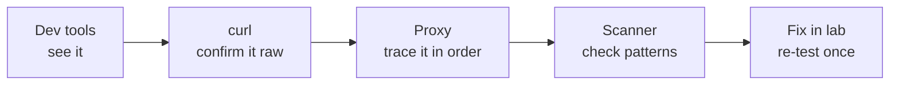
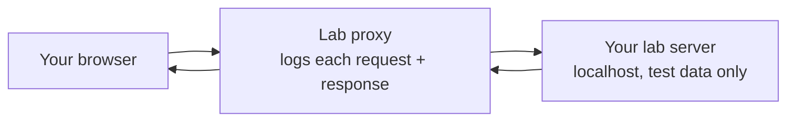

# Web Tools — Visual Notes

Lab only · a lab site you built yourself, or a deliberately vulnerable lab app on your own machine · test data only

Web tools make visible what is already there: requests, responses, headers, cookies, and design flaws in your own lab app. The skill is reading those, tracing them, and writing a clear note.

Never against a real website, login, or API without written permission. Test data only: `test-user`, `<test-password>`, `<lab-url>`, `<session-id>`, `<token>` — never a real secret in a note or screenshot. A lab finding means: note it, fix it in your own lab app, re-test it.

## 1. The four tools, at a glance

| Tool | Shows you | Use it when |
|---|---|---|
| Browser dev tools | Requests, HTML, CSS, JS, cookies, console | First, every time — already installed |
| `curl` | Raw request and response, one endpoint at a time | You want headers and body without rendering |
| Lab proxy | Every request and response, in order | Tracing a lab login, form, or API call |
| Lab scanner | Automated checks for common patterns | After manual tracing, one lab app, slowly |



## 2. Browser developer tools — first, every time

On your own lab page only (`http://127.0.0.1:<lab-port>/`):

1. Open dev tools → Network tab → clear it → reload once.
2. Click the main HTML request. Read method, status, request headers, response headers, body — in your own words.
3. Click a CSS or JS request. Note why the browser needed it.
4. Application / Storage → cookies for your lab site only. Note cookie **names** — not values — and whether HttpOnly is present. Close dev tools when done.

| Network tab row | Means |
|---|---|
| One row | One HTTP request: method, path, status, size, time |
| 200 | That request succeeded, for that resource, at that time |
| Large / slow, console error | Clues, not verdicts — check the resource itself |

**Watch out:** dev tools can't "hack" a page — they only show what the browser already received, and edits there only change your own browser view, not the server. Clear the Network tab before reloading, or you'll read old requests as new.

## 3. `curl` — the browser without the page

`curl` makes HTTP requests and shows the response without rendering. A browser hides details; `curl` shows status line, headers, body, and, with the right flags, the request it sent. That is how you actually learn HTTP.

Against your own lab web service only, one endpoint at a time:

```bash
curl -i http://127.0.0.1:<lab-port>/
curl -i http://127.0.0.1:<lab-port>/lab-notes
```

`-i` includes response headers, not just the body. The second asks for a lab notes page you created yourself, if you have one.

`HTTP/1.1 200 OK` = that lab endpoint returned success for that request. `Content-Type: text/html` = HTML body; `application/json` = JSON. `Set-Cookie: session_id=<...>` = lab server asked the browser to store a session cookie — in a note, write `<session-id>`, not the real value. Body = the actual page or data.

**Watch out:** don't send a real password or token with `curl`, then share history or a screenshot publicly. A `curl` success only means the service responded to that one request — not that it is secure. Don't follow redirects blindly or download a file unchecked, even in lab.

## 4. Web proxy in lab — seeing requests in the middle

A proxy sits between your browser and your lab server, showing each request and response — your own lab traffic only. Like the Network tab, with more header and body detail.



Lab setup, in outline:

1. Start your lab web service (test data only, localhost) and a lab proxy tool on your own machine, following its own docs, for lab traffic only.
2. Configure your browser to use that proxy for lab traffic only, if required. Open your lab page once and read the proxy log: one request, method, path, status, headers, body, in order. If allowed, pause one lab request, read it, release it unchanged.
3. When done: turn the proxy off, restore browser settings, stop the lab service.

A changed request is not what the browser originally sent — note original vs changed, test data only. A proxy proves what was requested and returned, not that a flaw exists. Only bypass a lab check when deliberately testing your own lab fix, with a note about what you changed and why.

**Watch out:** leaving a proxy on after lab is a mistake. Intercepting traffic that is not yours — other people, or a shared, school, or company network — is a privacy violation.

## 5. Web scanner in lab — automated checks, with limits

A scanner sends many requests to a web app, looking for common flaws: missing headers, known patterns, error messages. A checklist run by a program, not a human tester — it cannot understand your lab app's logic, permissions, or business rules.

Lab rhythm:

1. Build or install the lab app, test data only. Write in one sentence what you want the scanner to check.
2. Run it once, slowly, default safe settings for lab — one lab app at a time.
3. Read each finding: real flaw, or false positive? What request caused it? What would a safe design do instead?
4. Fix one finding, re-run once for that finding only, note whether it is gone. Stop the app and scanner; summarise with placeholders.

| Scanner says | Means | Doesn't mean |
|---|---|---|
| A finding | This lab app behaved in a way that matches a common pattern | This app is exploitable |
| No findings | No known pattern matched, in that scan | This app is secure — logic, permissions, custom flaws aren't checked |

**Watch out:** scanners are noisy, logged, and can change or delete data through forms — even in lab. Never run one against a real website, login, or API. Don't run aggressive settings blind, or copy a report into a resume or public file without understanding each finding. "Free" and "common" are not permission.

## 6. Lab pass — one lab web check

1. Start the lab app on localhost, test data only. Browser + dev tools Network tab: reload once, trace the main request.
2. `curl -i` once against the same lab URL. Compare status and headers with the browser trace — do they match?
3. Proxy log for that one session, in order, if you have one. Scanner once, slowly, against that one app only, if you have one; check each finding by tracing the request yourself.
4. For each real flaw, note: what it is, what request caused it, what a safe design does instead, how you fixed it. Re-test the fix once, same tool, that finding only.
5. Clean up: stop the lab app, turn off the proxy, close dev tools, don't publish real tokens, cookies, or data.

That is the tool mindset from `tools-overview.md`, applied to the web: question first, smallest tool first, trace, note, fix in lab, re-test once.

**Watch out:** a web tool can change data, even in lab, if it submits a form or follows a deleting link. Use test data, be ready to rebuild your lab app. A lab server or proxy left on after lab ends is how a tidy session turns into a leak.

**Done when you can:** trace one lab request through dev tools, `curl`, and (if you use one) a proxy log, and say what each one added.

Next → `password-tools.md`

---
*Lab only: systems you own or have written permission to test, test data only. Never publish a real username, password, token, cookie value, or real URL with a secret.*
