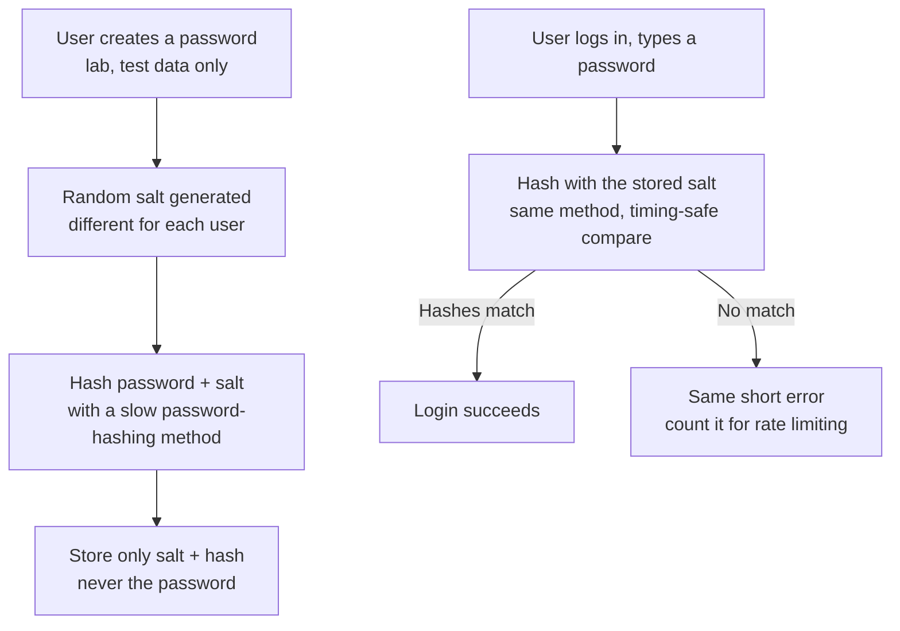

# Password Tools — Visual Notes

Lab only · test passwords only · never a real password, hash, or username in a note

Password tools are not for breaking other people's passwords. They teach what makes a password strong, how a good system stores it, and how to check your own test passwords safely.

## 1. What a password system has to get right

A password is one factor: something you know. Something you have (phone, key) and something you are (fingerprint) are later topics.

| Part | Job | A flaw here means |
|---|---|---|
| Creation | How a user chooses a password, checked for weakness? | Weak passwords get in |
| Storage | Plain text — never — or a hash? (see §4) | Every password leaks at once |
| Checking | Compare typed vs stored, without leaking which part was wrong, without unlimited guesses | Guessing runs free |

Check all three later, in a lab app you built yourself — not a real app.

## 2. What makes a password strong — in order

| Factor | Why it matters | In short |
|---|---|---|
| **1. Length — matters most** | Each extra character adds another wheel to the combination lock, multiplying the combinations | A 16-character phrase of four random words beats a short password with symbols |
| **2. Unpredictability** | Guessing starts with common lists, not random tries | Random or unrelated words beat a common word, name, date, or pattern |
| **3. Character types** | Upper, lower, digits, symbols increase the guessing space | Helps a little vs length — a short password with symbols is still short |

Short + common = weak. Short + symbols = still weak. Long, unrelated words + number + symbol = stronger — length and unpredictability, not the symbol alone.

Habits that matter as much as strength:

- Don't reuse across sites — one leak then opens every site using it.
- Don't use a name, pet name, birthday, or common word with a number at the end — exactly what a lab checker should reject.
- Don't share a password in a note, screenshot, or chat, even a test one that looks real. In notes, write `<test-password>`.

## 3. Your checker — the simplest password tool

You already built a simple checker in your first project, with length and has-number checks. Extend it in lab the same small-step way, test passwords only:

1. Take a test password only — write `<test-password>` in any note, never the value itself.
2. Measure length: under 12 is too short for a real password, in lab terms.
3. Check lower, upper, digit, symbol. Count how many of the four types are present.
4. Verdict — weak, medium, or strong — length first, then types.
5. Don't save it, don't send it anywhere, don't use it as a real password.

**Watch out:** "strong" does not mean safe to reuse everywhere — reuse, storage, and guessing limits matter too. Never check a real password in an online checker — that sends your secret to someone else. Test passwords only, on your own machine only.

## 4. Why common passwords fail — and what a good design does

Guessing does not start randomly. It starts, in order: common passwords, dictionary words, names, dates, patterns, then combinations of those.

That matters for defence, not attack: a system must require longer passwords, reject common passwords, limit tries, and lock or slow down after repeated failures.

For a lab app you built yourself, test accounts only:

| Design rule | In your lab app |
|---|---|
| Reject common passwords | Reject test passwords in a small common list you write in lab |
| Require length | Minimum 12 characters or more for a real password |
| Limit tries | Limit tries, slow failures, log safely with no secrets in the log |
| Same error, always | "Username or password is incorrect." — never say which part was wrong |

Uncommon is not enough — a password can still be short, predictable, or reused. Length, unpredictability, and not reusing matter together.

This file deliberately gives no list of real passwords to try, no method to guess a real account, and no tool to use against a real system. The learning task is designing a lab system that rejects common passwords and limits tries.

## 5. Hashing and salting — how a good system stores passwords

A good system never stores a password in plain text — anyone reading the storage file would read every password. Instead, it stores a hash.

| Term | Means | Why |
|---|---|---|
| Hash | A one-way fingerprint — password → hash works, hash → password does not, by design | The system never needs to store the password itself |
| Salt | A random value, different for each user, added before hashing | Two users with the same password get different hashes; pre-made hash lists won't work directly |
| Slow hashing | A hashing method designed for passwords, deliberately slow | Guessing takes a long time; fast hashes, designed for files, let guessing go fast |

Password hashing must be slow, salted, and one-way. The exact method name is a later topic — don't implement your own password storage from this file alone, and never store a real password in a lab file to "test" hashing.

**Watch out:** if a lab app stores plain text, fix it in lab now — hash plus salt, or remove passwords from that app. "It's only a lab" is no excuse; a lab habit becomes a real habit. Don't publish a real hash as "only a hash" — a weak password's hash can be guessed from common words.

## 6. Password managers and multi-factor

| Tool | Solves | Doesn't solve |
|---|---|---|
| Password manager | Long, random passwords per site, stored encrypted with one strong master password, filled in | MFA — it helps with passwords, not a second factor |
| Multi-factor (MFA) | Two or more factors — e.g. password (know) + code from an app or security key (have) | Protection on other sites — MFA on one site doesn't protect another |

Even if a password leaks, MFA means an attacker still needs the second factor. Not a lab task — a real-life habit for real accounts, including GitHub: a password manager, long random passwords per site, MFA where offered, especially email and GitHub. Never share a master password or an MFA code — a code is a secret, for one use, for a short time.

## 7. Lab pass — try it now

Extend your checker (§3) in lab, test passwords only. Print length, types present, and verdict — length first, then types. In your note, write only: length band, types present, verdict, and `<test-password>`, never the value.

Next → `system-tools.md`, then `safe-labs.md`

---
*Lab only: systems you own or have written permission to test, test data only. Never publish a real password, real hash, real username, or real personal data.*
