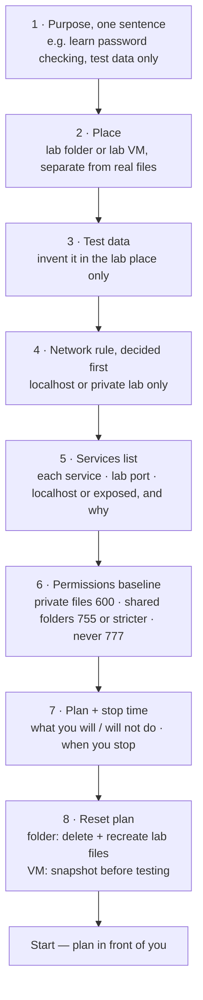
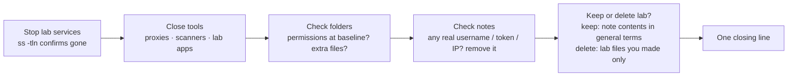

# Safe Labs — Visual Notes

Lab only · own machine / own private lab only · test data only

The one rule above all rules: practise only on systems you own, or systems you have written permission to test, with test data only, in a lab you control. "I only wanted to learn", "I didn't change anything", "It was public", "Everyone does it" — none of those is permission. When in doubt, stop and ask: is this clearly my own lab? If the answer is not a clear yes, don't start.

## 1. What makes a lab safe

| Part | Means |
|---|---|
| Separate | Lab machines/folders separate from real documents, real accounts, real personal files |
| Test data only | Test usernames, `<test-password>` placeholders, sample files you made yourself — no real passwords, personal data, or customer data |
| Clear boundaries | A written plan: what you will do, what you will not do, when you stop and clean up |

A lab that is not separate is not a lab. Lab files mixed with real documents, lab passwords matching real passwords, or a lab server exposed to a real network — a lab mistake there becomes a real leak. Separation comes before any tool.

## 2. The 3 kinds of lab

| Lab | Best for | Limit to respect |
|---|---|---|
| **Lab folder** on your own machine (e.g. `lab-test` in your home folder) | Python labs, password checker with test data, own-machine audits, localhost-only web servers | Shares your real machine — lab files only in that folder, lab services localhost only, no real files inside it |
| **VM** on your own computer | A whole separate system, a deliberately vulnerable lab app, checks you can reset without touching your real machine | Same rules in a new shape: test data only, lab network only, snapshot before testing so you can reset |
| **Cloud / course lab**, your own account | Guided practice rooms where the platform already set up a safe target, with a clear scope and end point | The platform's scope IS the permission — don't go outside it, don't test the platform itself, don't use it against a real system outside it |

Start with a lab folder. Move to a VM when you need a whole separate system. Use a cloud lab only when a course gives you a clear, written scope, and stay inside it. A simple lab with clear rules beats a complex lab with none.

## 3. Build a lab, in order

**Watch out:** starting a lab server on all interfaces because the default did that and you didn't check — always run `ss -tln` after starting a lab service and bind it to localhost only.

## 4. Ten rules for every session

| # | Rule | In practice |
|---|---|---|
| 1 | Own lab only | Systems you own, or written permission, in a lab you control |
| 2 | Test data only | Invented usernames, `<test-password>`, sample files you made — no real data |
| 3 | Separate from real life | Lab folders, VMs, accounts never mixed with real documents or accounts |
| 4 | Localhost / private lab network only | Never a school, company, public Wi-Fi, or real network for learning labs |
| 5 | One question, one tool, one check | Small, slow, documented beats fast, broad, undocumented |
| 6 | Read output, write a note — placeholders only | Summarised note, not raw tool output with real details |
| 7 | No private file contents | Permissions, names, numbers only — never private keys, password files, personal contents |
| 8 | Clean up when done | Stop services, close tools, delete/secure lab test files as planned |
| 9 | If in doubt, stop and ask | Unsure about scope, data, or a tool? Stop before running it, ask with a clear description |
| 10 | A lab finding is a design lesson | Note the design mistake, fix it in your own lab, re-test — never use it against a real system without written permission |

These are not extra work. They are the work — practised trust, session after session, is what earns a real scope later.

## 5. Networks — three kinds, don't confuse them

| Network | What it is | Lab use |
|---|---|---|
| Localhost — `127.0.0.1`, `::1` | Your own machine talking to itself; traffic never leaves the machine | Safest for learning — no other machine involved |
| Private lab network | A network you created for lab only, lab machines you own, no real users on it (e.g. VM host-only / NAT, lab VMs only) | Second choice, only if it holds lab machines + test data only |
| Real network | School, company, public Wi-Fi, internet — real users, real systems, real rules | Never for learning labs, unless you hold a clear written scope for a specific authorised test — a later phase, not a lab |

**Watch out:** availability is not permission — a school or company network being reachable does not make it a lab. And "private" alone doesn't make a lab network safe; it is safe only with lab machines, test data, and no real users on it.

## 6. Data — three kinds, don't confuse them

| Kind | Examples | Rule |
|---|---|---|
| Test data | Invented usernames, `<test-password>`, sample notes/files you made | Safe to share in a lab note, with placeholders |
| Real data | Data about a real person, account, or system | Never in a lab, never in a note, screenshot, or public file |
| Secrets | Passwords, tokens, session IDs, private keys, codes | Never as test data, never shared, never published — even if they look like test data |

If you aren't sure whether data is test or real, treat it as real: don't use it, don't share it, until you've confirmed you created it yourself. A real password with a small change is not a test password — use a completely invented word or `<test-password>`.

## 7. Cleanup — the end of every session

Closing line: "Lab cleaned, services stopped, notes checked, lab kept / deleted."

**Watch out:** `ls` a folder before deleting it — don't delete real files you mistook for lab files. A lab never cleaned up becomes a real risk: services left running, folders left open, reports left with personal details.

## 8. When a lab goes wrong

| Situation | Stop, then |
|---|---|
| Lab test breaks your own lab app | Stop testing. Read the error in lab terms. Reset (recreate test files / restore VM snapshot). Note what broke, suspected cause, what you'll do differently. Restart smaller, once, slowly. |
| You tested outside scope by mistake | Stop immediately. Don't run more tests. Don't delete logs or notes to hide it. Write down privately what happened and when, in general terms, no secrets. Tell a teacher, mentor, or the system owner and ask what to do next. Update your plan so it doesn't repeat. |
| A note contains real personal data | Stop sharing it immediately. Remove the real data from your private copy; don't share the old version. If already public, ask for help removing it and change any real password/token in it at once, on the real account. Rewrite the note with placeholders only. |

Mistakes handled honestly are learning. Mistakes hidden or repeated are risk.

**Done when you can:** build a lab from the flowchart, state why each of the ten rules exists in plain words, and close a session with the cleanup line — with zero real details anywhere.

Next → `07-practice/practice-notes.md`

---
*Lab only: systems you own or have written permission to test, test data only.*
