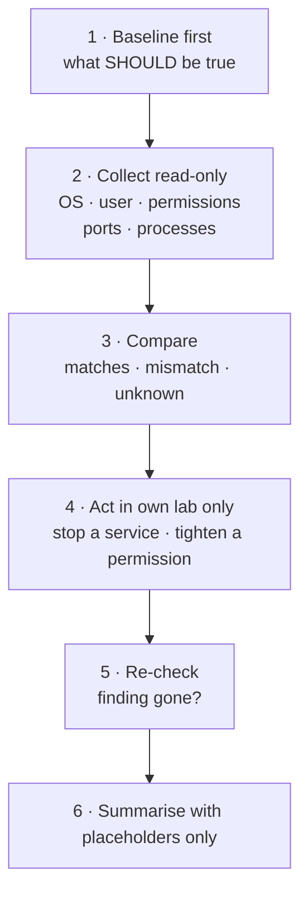
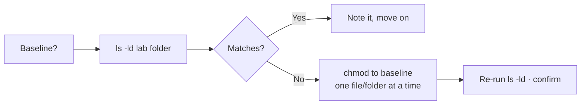

# System Tools — Visual Notes

Lab only · own machine only · test data only

An audit is a report, not a hack and not a fix. It collects facts read-only, compares them to a baseline you wrote first, and ends with actions you re-check. Running a tool and admiring a long report is not the work — acting on one finding and re-checking it is.

## 1. The audit flow



| Step | Question it answers |
|---|---|
| Baseline | What should be listening? What permissions should a lab folder have? |
| Collect | What is actually true, right now, on this machine? |
| Compare | Which facts match, which don't, which are unknown? |
| Act + re-check | Did the fix work, proved by a second run? |

Example baseline, in one line: only localhost ports listening · lab folders 755 or stricter · private test files 600.

## 2. OS and user — who and where

```bash
uname -a    # OS, kernel, machine type
whoami      # current user
id          # user ID, group ID, groups
hostname    # machine name
```

| Command | What it tells you | In a public note, write |
|---|---|---|
| `uname -a` | OS + kernel + machine type | "Linux, lab machine" — not the full string |
| `whoami` | Current username | `your-user` |
| `id` | Groups — which group permissions apply to you | Group names in general terms only |
| `hostname` | Machine name | `<lab-host>`, or omit it |

**Watch out:** full `uname -a` + `hostname` + `whoami` together is a fingerprint of your machine. Summarise it; never publish the raw set.

## 3. Permissions — who can read, write, run

```bash
ls -ld <lab-folder>              # the folder itself, not its contents
ls -l <lab-folder>               # each file inside it
stat <lab-folder>/<test-file>    # size, permissions, owner, times
```

| Value | Read | Write | Execute / enter folder |
|---|---|---|---|
| Number | 4 | 2 | 1 |

| Number | Owner | Group | Others | Use |
|---|---|---|---|---|
| 755 | rwx | r-x | r-x | Shared lab folder |
| 775 | rwx | rwx | r-x | Shared lab folder, group writes |
| 644 | rw- | r-- | r-- | Ordinary lab file |
| 600 | rw- | --- | --- | Private test file |

Read a number back in plain words before you change anything:

```
775  =  owner rwx  ·  group rwx  ·  others r-x
644  =  owner rw-  ·  group r--  ·  others r--
600  =  owner rw-  ·  group ---  ·  others ---
```

Flow for a mismatch:



**Watch out:**
- Never `777` to "fix" a permission problem — that removes all protection. Use the smallest permission that still lets the lab work.
- Never `chmod -R` on a large folder without knowing what is in it. One file at a time, check after each change.
- Never read a private key or password file to "check" it. Permissions only, never contents.

## 4. Ports and processes — doors and workers

```bash
ss -tln          # TCP listening ports, own machine only
ps aux | head    # first look at running processes
```

| `ss` address | Means | Verdict |
|---|---|---|
| `127.0.0.1:<lab-port>` | Localhost only — this machine only | Normal, if it's a lab service you started |
| `0.0.0.0:<lab-port>` | Exposed to the network | Finding — stop it, or bind it to localhost only |

| Check | Read it as |
|---|---|
| Listening port | A door waiting — problem or not depends on the service, the address, and whether you need it in lab |
| Running process | A worker — unfamiliar name is a question, not a verdict; identify it from your lab setup before acting |
| Port gone after stop | Fix proved — a fix is not done until the re-check confirms it |

**Watch out:** don't kill a system process you don't understand — unfamiliar names are often normal. Don't share a full `ss` or `ps` output publicly; summarise counts and unexpected items, with placeholders.

## 5. Updates — is the lab base current?

| Check | How, in general terms |
|---|---|
| Updates available? | Your own system's update tool, on your own machine only |
| Security updates? | Note how many, and whether any are security — not a full package/version list in a public note |
| Lab project parts | Keep a simple list: component, version, source — check it from time to time |
| After updating | Re-run a small audit: `ss -tln` + one lab folder permission check |

Don't update everything at once with no test and then not know what broke the lab — one at a time, in lab first. Don't never update either — known flaws accumulate over time.

## 6. Safe summary format

A report is a short summary, not a copy of tool output. Use this shape:

| Section | Content, placeholders only |
|---|---|
| Title + date | "Own-machine audit, lab, `<date>`" |
| Scope | "My own machine only, lab folders and localhost ports only" |
| Baseline | "Only localhost ports listening · lab folders 755 or stricter · private test files 600" |
| Findings | One line each: "Port `<lab-port>`, localhost only, matches baseline" / "Port `<lab-port>`, exposed, lab service, action: stop service, re-checked, now gone" |
| Next actions | One line each, no personal details |
| Not checked | "Private file contents, other machines, remote hosts were not checked" |

Never in a summary: a real username, hostname, real IP, real personal file path, a full process list, or a fingerprint of your machine. A finding without a baseline and an action is just a fact. A finding with both is useful.

## 7. Lab pass — try it now

```bash
ls -ld ~/lab-test
ls -l ~/lab-test
ss -tln
ps aux | head -20
```

For each port: localhost-only, or exposed? For each permission: matches your baseline, or fix + re-check? End the session by stopping lab services you don't need, and never publish the full report — a private report stays private until every personal detail is removed and that exact file is approved.

**Done when you can:** run the audit flow on your own machine, explain each finding against a baseline you wrote first, and write a summary that contains zero real details.

Next → `safe-labs.md`

---
*Lab only: systems you own or have written permission to test, test data only.*
