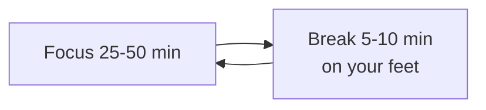
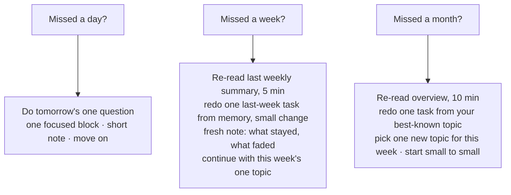

# Daily Practice — Visual Notes

Lab only · heavy lab at home, on your own machine · test data only

An earlier version of this roadmap mentioned a 16-hour active day, 6am to 10pm. That's sixteen hours awake and active — college, library, meals, movement, rest, English, focused practice — not sixteen hours of non-stop study. Sleep, food, movement, and real responsibilities come first. Practice fits around them, not instead of them.

## 1. Focused blocks, not long hours

| Block | Rule |
|---|---|
| Length | 25–50 minutes, one thing, one clear question, one clear end — 50 is the upper limit |
| During | No phone, no switching, no multitasking — multitasking in a learning block is just switching, and switching costs learning |
| Break | 5–10 minutes, on your feet: stand, walk, stretch, drink water, look away — the break is part of the block, not a reward |
| Tired? | Stop. One honest block, noted, beats three exhausted ones you can't remember. |

A three-hour unbroken stretch is long work, not focused work.

## 2. Sample day — college 10am to 7pm

A sample, not a rule — change the times to fit your real day and energy.

| Time | Block | What happens |
|---|---|---|
| ~6:00–7:00 | Morning routine | Wake, move a little, eat. No lab yet — fuel before focus. |
| ~7:15–9:15 | New hard thing, before college | Freshest slot: Python from zero, small to small, one new idea checked, short note at the end, movement break every 50 minutes |
| Travel | Light review only | Re-read yesterday's short note in a minute on your phone. No lab. |
| 10:00–19:00 | College + library | College work first — that's why you're there. Then light self-study only (see §4). Move every 50 minutes. |
| After 19:00 | Rest first | Travel, food, a short pause |
| ~19:30–20:30 | Hands-on evening block | One block on your own machine: own-machine audit, localhost-only lab web server, password checker with test data, a small tool. Two only if you genuinely have the energy. |
| After lab | Light close | Re-read today's note, write tomorrow's one question in a single sentence, clean up the lab — stop services, check notes for real details |
| ~21:00–21:45 | English block | Record a short private explanation, 5–10 minutes, of one thing learned today, in your own words, no script read word for word. Listen once, note one clear thing + one thing to improve, stop. |
| ~22:00 | Sleep | Consolidation happens in sleep, not in extra hours awake |

**Watch out:** light study in the library, heavy lab at home. Never run lab tools on a library system or library network — it's not your lab.

## 3. Sample week — one topic, many small sessions

| Day | Work |
|---|---|
| Monday | One new idea, small to small, in the lab, with a short note |
| Tuesday | Yesterday's idea from memory, with a small change, + one new small idea |
| Wednesday | Monday + Tuesday together in one lab task; any part that fails becomes a failure note with a next step |
| Thursday | Small project, or a small part of one, using the week's ideas — password checker, audit script, localhost lab server, all test data only |
| Friday | Review: 20 minutes over the week's notes, one Monday task redone from memory with a small change, short weekly summary — learned · practised · failed · stayed · next |
| Saturday | Project day: build, test, fix, short write-up with placeholders only — what you built, why, what you learned |
| Sunday | Rest, light review, planning: re-read the week's summary in 10 minutes, pick next week's one main topic in a single sentence, no heavy lab unless you have the energy and still sleep on time |

Rest is part of the week, not a gap in it. Review + a project turn learning into proof: a script, a note, a write-up you can show, after checking it for real details.

## 4. Library blocks — light study only

| Do in the library | Don't do in the library |
|---|---|
| Reading, writing, vocabulary in your own example sentences | Heavy lab, lab tools, scans |
| One written logic problem in plain English: inputs · parts you can trust · where it could fail | Anything on a shared system or network that isn't yours |
| Plan the next lab session in one sentence — question · what you expect to see · next step — so home starts immediately | Leave notes with lab details open on a shared screen |

When you leave a shared machine: log out, close files, take your notes with you.

## 5. Phone practice with Termux

| Rule | Detail |
|---|---|
| What it's for | Python + Linux commands on your own phone only, test data only — a mobile practice lab, not a Kali replacement |
| Length | 10–20 minutes: one small script or a few commands in Termux's own home folder, on test files you made there, short note, close it |
| Keep separate | Its own folder, separate from real personal files; never with real personal files or a real account in the same session |
| What it's not for | Testing other phones or networks, heavy lab — a phone is not a laptop, and heavy lab on it only frustrates |

A ten-minute phone session, noted, counts. The same session, unnoted, fades — which is why people say phone practice "did not work" when what really happened is it was never written down.

## 6. English block — one recording a day

| Step | Detail |
|---|---|
| Record | 5–10 minutes, one thing learned today, your own words, no script read word for word |
| Listen | Once — note one thing that was clear, one thing to improve |
| Stop | One recording, one listen, one improvement a day is enough |

A short, imperfect recording done daily beats a long, perfect speech never recorded. Simple, clear English in logical order is advanced; complicated words out of order are not.

## 7. Low-energy days and college pressure

| Situation | Shrink, don't cancel, don't force |
|---|---|
| Tired / college ran long / deadline ate the evening | 10-minute Termux session for one Python idea, or re-read yesterday's note + write tomorrow's question — the chain stays alive, and that's the thing that matters over months |
| Exam / assignment week | College work takes priority; lab shrinks to one small block a day, named openly in your note: "this week is college-heavy, lab is one small block a day" |
| Energy pattern | Learn yours, don't fight it — clearest in the morning? Protect that slot for the hardest new idea. Mornings slow? Swap: light review in the morning, new idea in the evening when you're actually awake. After a few weeks your notes will show when you actually learn well — trust that pattern over any template |

A plan you adjust openly is a plan you can return to; a plan you silently abandon is not. And decide tomorrow's question tonight — one sentence, with what you expect to see — or you lose twenty minutes each morning wondering what to practise. A tidy lab with a question waiting is much easier to return to than a lab left mid-mess.

## 8. When you miss a day

Don't catch up by doing two days in one day — catch-up days are burnout days. Don't restart from the beginning — a restart is a small start, not a big restart. Write the miss down honestly: a note saying you missed a week because of exams and are restarting with one block tomorrow is a note you can trust. Guilt says you're behind, so do extra, so you're tired, so you miss another day — the restart rule breaks that loop.

## 9. Making the rhythm yours

After a month or so, follow your own notes, not the sample. Look back at four weekly summaries: which blocks actually happened? Which kept getting skipped, and why — wrong time, too long, too hard, not useful? Which sessions produced write-ups you're proud of, and what did they have in common? The answers are your real rhythm — built from your own evidence, it's one you can keep for a year.

Same for topics: a kind of task that consistently leaves a clear note deserves more time, even if it isn't flashy. A topic stuck with no progress means break it smaller and check the prerequisite one phase back — a skimmed networking idea, a Linux command never really practised. Going back one step isn't going backwards; it's how the next step becomes possible. Keep the rhythm boring on purpose: same slots, same note, same Sunday review, repeated without drama. The exciting days happen inside that rhythm, not instead of it.

Next → `progress-checklist.md`

---
*Lab only: systems you own or have written permission to test, test data only.*
