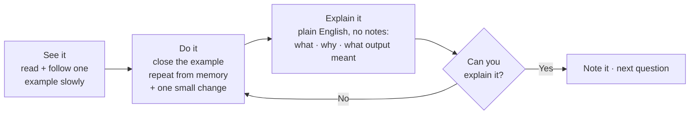
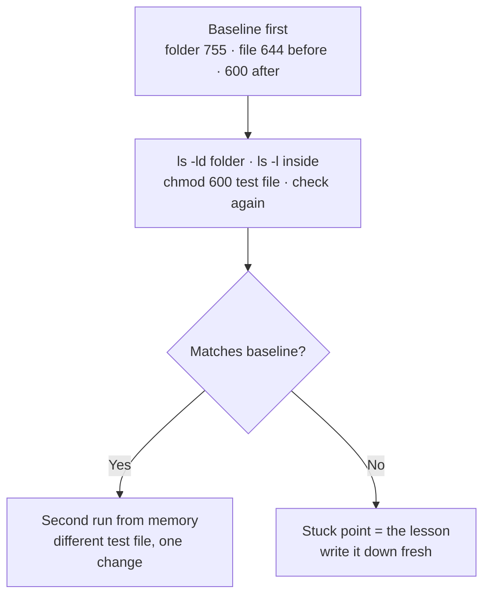

# Practice Notes — Visual Notes

Lab only · own machine / own private lab only · test data only

Reading tells you something exists. Skill is what you can do without looking at the answer — slowly at first, then faster, with fewer mistakes. This file is about turning reading into skill that stays.

## 1. The practice loop

Familiarity feels like skill and fades fast. If you can't explain it without looking, doing it again — not re-reading — is the fix.

One session, permissions as an example:

**Watch out:** `ls -l` on a folder shows its contents; `ls -ld` shows the folder itself. Mixing those up isn't a wasted session — it's exactly the lesson, and exactly why the second, from-memory run matters.

## 2. Small to small

One command, one flag, one check — don't move on until the current piece makes sense. If it fails, stop there: fix it, or write down exactly where it failed, before pushing forward.

| Step | Example — a new network check |
|---|---|
| 1 · One command | `ss -tln` on your own machine — say in one sentence what it shows: listening TCP ports |
| 2 · Split the output | Localhost-only ports vs exposed ports |
| 3 · One exposed port | What lab service is it, do you need it? |
| 4 · Act + verify | Stop a lab service you don't need, re-run the check, confirm it's gone |
| 5 · Only then | Describe the whole audit from memory |

Each small check tells you exactly where you stand. That's what makes a long roadmap survivable day after day.

## 3. The note after the session — 5 lines, no more

| Line | Write |
|---|---|
| 1 · What | The one thing you practised |
| 2 · Did | What you did, in general terms — command names, not pasted full output |
| 3 · Result | Did it match your baseline? If not, why? |
| 4 · Stuck | Where you got stuck, in one sentence, and what you learned from it |
| 5 · Next | The one thing you'll practise next time |

Short is a feature: a five-line note is easy to write, easy to re-read, and hard to accidentally fill with real personal details. A fifty-line note of tool output is hard to write, hard to re-read, and likely to leak something it shouldn't. Re-read yesterday's note before today's session, in about a minute — that one habit turns isolated sessions into a chain.

A note with no stuck point has no lesson. A note with no next step means the next session starts from zero. A note you never re-read wasn't worth writing.

## 4. Failure notes — keep them separate

Success notes say what already works. Failure notes say where understanding has a gap — and a gap written clearly is a gap you can close.

| Field | Example |
|---|---|
| Tried | Started a local web server on `127.0.0.1`, lab port in use |
| Happened | Port already in use — server wouldn't start |
| Suspected cause | Left an earlier lab server running, skipped cleanup last time |
| Next step | Check listening ports on your own machine, stop the old lab server, try again, clean up properly at the end |
| After the fix | Keep the note, fix written next to it |

Over time you'll see patterns: the same kinds of failures recurring, and the ones genuinely fixed for good. Don't write "it did not work" and stop — that's a feeling, not a note. Check your own step first before blaming the tool or the tutorial; a smaller test usually shows exactly where your step went wrong.

## 5. Review — doing, not re-reading

Re-reading feels easy, and that easy feeling misleads. Review is redoing.

| When | Redo |
|---|---|
| Weekly | One task from last week, from memory, with a small change |
| Monthly | One task from last month's topic + a fresh short note on what stayed and what faded |
| Monthly | Explain one topic out loud or in writing, without looking — whatever you can't explain goes back to practice, not back to reading |

Review one thing well rather than ten things badly. A task you can do after a week, from memory, is a skill. A task you can only do immediately after reading is not yet one.

## 6. Picking what to practise

One thing well beats ten things badly. Collecting tools all evening feels busy; busy is not progress. Depth is: one tool understood properly — what it does, what its output means, where it misleads you — beats ten tools run with copied flags.

| Rule | Means |
|---|---|
| One main thing per session | Checker session = the checker: test data only, a few test passwords, what the verdict means and where it's wrong |
| One main topic per week | Small sessions + a small project — a script, a note, a write-up left behind |
| Change one variable | Same easy test file every time rehearses success — change one thing, watch what breaks, ask why this input gave that result |

A week with a new topic every day leaves familiarity, which feels like learning right up until someone asks you to do the thing without notes.

## 7. Write-ups and honesty

A write-up after a lab task is the explanation stage, written down: setup in generic terms → what you tried → what you found → what you'd fix or do differently. Use `127.0.0.1` or `<your-lab-ip>` and `example.com` if you need an example — never a real target. The sentence you can't finish is the part you don't understand yet — that's your next practice question. Over months, write-ups become the portfolio: proof you did the work and understood it.

Be honest in private and public: what you actually did, failed at, and don't understand yet, no exaggeration, no hidden failures. A public claim should match a private note backed by a task you can do from memory. A note saying you got stuck at a specific point and are practising it next is a note you can defend — and practising on a real system to look better is a shortcut that costs trust, not ambition.

**Done when you can:** do a recent task from memory with one small change, write the 5-line note including a real stuck point, and explain the task out loud without looking.

Next → `daily-practice.md`

---
*Lab only: systems you own or have written permission to test, test data only.*
