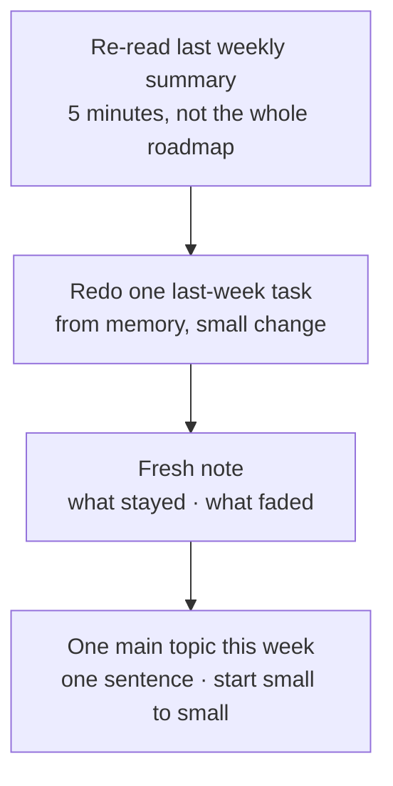
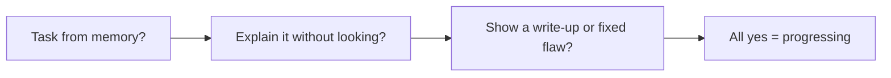

# Tracking Progress Honestly — Visual Notes

Lab only · own machine / own lab only · test data only

Progress is easy to fake. Months of reading and running commands can feel busy without improving you; far less time in focused lab sessions can. The difference isn't effort — it's proof.

## 1. What counts as proof — only three kinds

| Proof | What it looks like |
|---|---|
| Lab task from memory | Do it now, without looking, with a small change from the practised version — different lab folder, test file, or port on your own machine — result matching what you expected before starting |
| Short write-up, your own words | A few paragraphs after a lab task: setup in generic terms · what you tried · what you found · what you'd fix or do differently — and you can explain it aloud without reading it word for word |
| Fixed lab flaw | Found something wrong in your own lab — folder too open, service listening where it shouldn't, test password rightly called weak — fixed it, checked the fix, wrote down what changed |

Page-open doing is familiarity, not skill. Anyone can paste output; explaining it is the work, and the sentence you can't finish is your next practice question. No one of these three for a topic means it isn't finished yet — practise it from memory, write the explanation, or find and fix a flaw.

## 2. Review at three scales

| Scale | Do | Answers |
|---|---|---|
| Daily | Re-read today's note; write tomorrow's one question in a single sentence | Did I do the one thing planned? Did the result match expectations? Where did I get stuck? |
| Weekly | Re-read the week's notes in ~20 minutes; summary — learned · practised · failed · stayed · next | What actually happened vs planned? Which sessions produced proof? Is the same failure recurring? |
| Monthly | Redo one last-month task from memory, small change; explain one topic without looking | What stayed, what faded? Unexplainable topics go back to practice, not reading. |

**Watch out:** counting is a trap. Pages read, tools run, hours sat at the desk feel objective and are mostly noise — hours sat down is not hours learned, tools run with the page open is not tools understood. Count proof instead: tasks from memory, write-ups explainable without notes, lab flaws found and fixed. That number is smaller and honest, which is why it's useful.

## 3. Busy-work vs real progress

| Busy-work — feels productive, leaves nothing | Real progress — slower, leaves something |
|---|---|
| Re-reading a file already read; re-running a task with the same easy test data | Getting stuck, writing down exactly where, fixing that specific piece |
| Collecting another tool without understanding the last one | Changing one variable and watching what breaks |
| Watching a walkthrough without touching the lab | Writing an explanation, finding a sentence you can't finish, practising that gap until you can |

Test after any session: can you do or explain something new? If no, it was busy-work, however long it took.

Two quieter signals: note specificity — vague early notes ("learned Linux commands") should become specific (which command, what it showed, what went wrong, what changed); notes staying vague means you're still reading. And polishing — rewriting notes, reorganising folders — fine in small doses, but if it isn't producing proof, it isn't progress; do the lab task first.

## 4. Progress, phase by phase

Judge each phase by proof, not pages.

| Phase | Done means you can, from memory, in your own lab |
|---|---|
| Fundamentals + Linux | Explain CPU, RAM, disk, OS, kernel, shell, file, user, group — and run the 5-check box sizing (identity, map, permissions, processes + ports, logs + drawing) against a baseline |
| Networks | Explain what a packet's journey proves and doesn't prove; separate localhost-only from exposed ports on your own machine and justify each exposed one |
| Web | Explain a request/response in plain terms and the OWASP ideas at lab level, with a localhost-only example, placeholders only |
| Tools | For each tool claimed: what it does, what its output means, where it misleads you — one tool understood beats ten run with copied flags |
| Passwords + systems | Check a password on test data and explain where its verdict is wrong; audit your own machine against a baseline, act on one finding, re-check it, summarise with placeholders only |
| Practice | Produce the three proofs regularly, plus a weekly summary you can defend |

A phase you can only repeat from reading, or run page-open, is still in progress — return to the specific failing piece, small to small. Notes gone vague → specific plus at least one proof means you can build on it.

## 5. Restarting after a missed week — or month

A missed week isn't a disaster; it only becomes one if it turns into a missed month. The way back is deliberately small.

| Gap | Restart |
|---|---|
| Missed week | Summary → one from-memory task → fresh note → this week's one topic. Don't cram two weeks into one, don't restart from the beginning — both feel serious and both usually end in burnout and another missed week. |
| Missed month | Re-read the overview, pick your best-known topic, redo one task from it, then one new topic for the week. Small starts are how long plans survive real life; big restarts are how they die. |

Note a gap's reason plainly — exams, family, health, travel — as fact, not excuse or guilt. Over a year, what matters is coming back quickly, without drama, every time.

## 6. Final check — three questions, any time

| # | Ask yourself |
|---|---|
| 1 | Can I do a recent lab task from memory, with a small change, and does the result match what I expected? |
| 2 | Can I explain a recent topic in plain English, without looking, in a few minutes? |
| 3 | Can I show a short write-up, or a fixed lab flaw, from the last few weeks, that I actually understand? |

All three yes: you're progressing. Any one no: that's your next practice.

---
*Lab only: systems you own or have written permission to test, test data only.*
