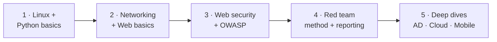
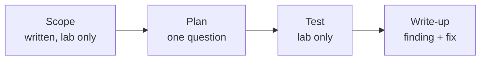

# Books — Visual Guide

Lab only · own machine · test data only

Read in order. One book at a time, with a lab pass after each chapter that matters. Reading without lab = notes that fade in a week.

## 1. Reading order, at a glance



| Order | Topic | What it gives you |
|---|---|---|
| 1 | Linux + Python | The ground everything else stands on |
| 2 | Networking + Web | How traffic and sites actually work |
| 3 | Web security | How web apps break, and how to test them safely in lab |
| 4 | Red team method | How a test is planned, run, and written up |
| 5 | Deep dives | AD, cloud, mobile — only after 1–4 are solid |

**Watch out:** collecting books is not learning. If a book is on your shelf for a month with no lab notes, it's decoration, not study.

## 2. Beginner — start here

| Book / area | Use it for | Skip / watch out |
|---|---|---|
| Linux basics guide (any current, beginner Linux book) | Commands, filesystem, permissions — the daily set in `02-fundamentals/` | Don't buy an old edition and follow old package commands blindly |
| Python basics, beginner level | `input`, loops, `if`, functions, small scripts — your password checker level | Stop at basics first. Don't jump to hacking tools in Python yet |
| Networking basics | IP, ports, TCP/UDP, DNS, HTTP — the map in `03-networks/` | Theory only is not enough — run `ss`, `ping`, `dig` in lab as you read |

**Lab pass after each book section:**
```
Read 1 chapter → run 1 lab command → write 5 lines: what, why, output, stuck, next
```

## 3. Web security — the core reading

| Book / area | Use it for | Lab rule |
|---|---|---|
| Web application security, beginner to intermediate | URLs, HTTP, cookies, sessions, forms, APIs — `04-web/` | Test only your own lab app, on localhost |
| OWASP Top 10 guide (official OWASP site, free) | A01–A10, one risk at a time, defence first | No real sites. Lab app only, test accounts only |
| Web Hacking 101-style bug-bounty write-ups (public, legal) | How real findings are explained: impact, steps, fix | Read for reporting style, not for copying attacks on real sites |

| OWASP risk | Read first, then lab |
|---|---|
| A01 Broken Access Control | Your own lab app, two test users, check who can see what |
| A02 Cryptographic Failures | HTTPS, storage, secrets — check your own lab config |
| A03 Injection | Your own lab form, test input only, see how input is handled |
| A04–A10 | One at a time, same pattern: read → lab → write-up |

## 4. Red team method and reporting

| Book / area | Use it for |
|---|---|
| Red team / penetration testing methodology guides | Planning, scope, rules of engagement, phases — in lab terms |
| Reporting and write-up examples (public, legal) | How to write: finding, impact, evidence, fix — in plain English |
| MITRE ATT&CK (free, official) | A map of tactics, not a recipe — use it to name what you did in lab, and to plan what to learn next |



**A good write-up, in one table:**

| Section | One line |
|---|---|
| Finding | What broke, in plain words |
| Impact | Why it matters, in lab terms |
| Evidence | Lab output, scrubbed, placeholders only |
| Fix | What change would stop it |

## 5. Deep dives — only after the core

| Area | When to start | Why wait |
|---|---|---|
| Active Directory | After Linux, networking, and web are solid | AD without basics = copying commands you don't understand |
| Cloud security | After networking and web, in your own lab account | Cloud bills and real accounts are not lab toys — use free tiers, with limits |
| Mobile security | After web APIs and Linux basics | Mobile needs both, plus its own tooling |
| Malware / reverse engineering | Much later, in an isolated lab VM only | This is a separate specialism — don't mix it into early red team work |

## 6. How to choose a book, fast

| Ask | Good answer | Bad answer |
|---|---|---|
| Is it current? | Last few years, or a classic still used in labs | Old commands, old tools, no updates |
| Does it have labs? | Exercises you can run in your own lab | Theory only, no hands-on |
| Does it match your phase? | Your current roadmap phase, not phase 5 | A deep book when you're still on basics |
| Can you explain it back? | After a chapter, you can explain it in 2 minutes | You finished it and can't explain one chapter |

**Rule:** 1 book at a time, 1 lab pass per chapter, 1 write-up per week. Finish it, then pick the next.

Next → `courses-platforms.md` · `resources-map.md`

---
*Lab only: systems you own or have written permission to test, test data only. No pirated links — use official / legal sources only.*
