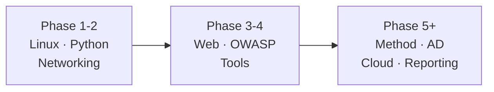

# Courses and Platforms — Visual Guide

Lab only · own machine / own lab account · test data only

Courses give structure. Platforms give a safe target. Neither replaces your own lab notes.

## 1. Pick by phase, not by hype



| Phase | Course type to pick | Avoid |
|---|---|---|
| 1–2 | Linux basics, Python basics, networking basics | Advanced hacking courses — too early, you'll copy, not learn |
| 3–4 | Web security, OWASP labs, tool basics in lab | Courses that test real sites — that's not a course, that's a rule break |
| 5+ | Pentest method, AD, cloud, reporting | Collecting certificates with no lab write-ups |

## 2. Free lab platforms — start here

| Platform | Good for | Watch out |
|---|---|---|
| TryHackMe (free rooms) | Guided rooms, Linux, web, OWASP, in a safe scope | Stay inside the room's scope. Don't test anything outside it |
| HackTheBox Academy (free / starter) | Structured modules, labs with a clear target | Don't jump to hard machines before basics |
| PortSwigger Web Security Academy (free) | Web + OWASP, with your own lab app to test | Lab only — the academy gives you the target, don't bring your own real target |
| OWASP Juice Shop (own lab, local) | A deliberately vulnerable lab app, on localhost, test accounts only | Run it locally, never expose it to a real network |
| MITRE ATT&CK (free reference) | Naming tactics, planning what to learn next | It's a map, not a step-by-step attack guide |

**Scope rule, every platform, every time:**
```
Inside the room / lab = test it
Outside the room / lab = don't touch it
No written scope = no test
```

## 3. Paid courses — when they are worth it

| Ask first | Worth it if | Not worth it if |
|---|---|---|
| Does it have labs I can actually run? | Yes, with a lab environment included | Video only, no lab |
| Does it match my current phase? | Yes — one phase ahead, not three | It's a famous name, but for a later phase |
| Will I finish it? | You have time for 1 course at a time, with notes | You're already on 3 unfinished courses |
| Does it leave proof? | Labs, write-ups, a small project at the end | Only a certificate, no work to show |

**Rule:** 1 paid course at a time, only after you've finished the free labs for that phase. A paid course doesn't fix a missing foundation.

## 4. YouTube / blogs / write-ups — how to use them safely

| Use them for | Don't use them for |
|---|---|
| Explaining one concept, fast, in plain words | A full learning plan — they're scattered, not a path |
| Reporting style — how a finding is written | Copying an attack on a real site |
| Tool demos in lab, to see what output looks like | Learning a tool with no lab of your own |

**Check before you trust a video / post:**
1. Is the target a lab, a room, or a test app? If it's real, stop.
2. Does it explain why, or just show commands? Commands without why fade fast.
3. Can you repeat it in your own lab, with test data? If not, it's entertainment, not study.

## 5. One course, one week — a simple rhythm

| Day | Do |
|---|---|
| Mon–Tue | Watch / read 1 module, run its lab, write 5 lines |
| Wed | Repeat the lab from memory, with a small change |
| Thu | Write-up: finding, impact, evidence (scrubbed), fix |
| Fri | Review the week's notes, pick next module |
| Sat | Project / room, in scope, with a write-up |
| Sun | Rest + plan next week, 1 sentence for the next topic |

## 6. Certificates — honest view

| Certificate | What it actually proves | What it doesn't prove |
|---|---|---|
| Any cert, alone | You passed a test / course | You can do the work in a real lab, under scope |
| Cert + lab write-ups + projects | You studied, practised, and can explain it | Everything — you still need real experience, over time |

**Order that works:** labs + write-ups first, certificate later, as proof of what you already did — not as a shortcut to skip the labs.

Next → `resources-map.md` · `books.md`

---
*Lab only: platforms and rooms only within their written scope, test data only. No pirated courses, no real targets.*
