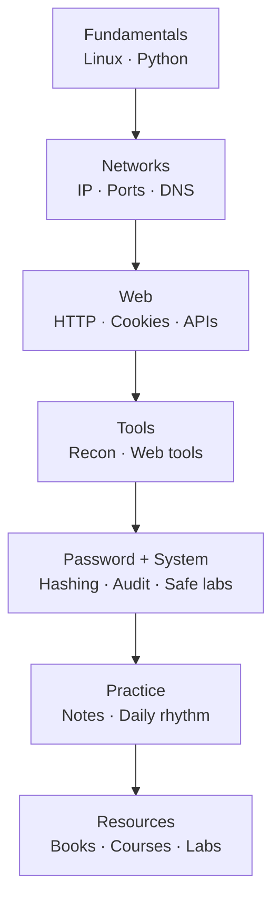
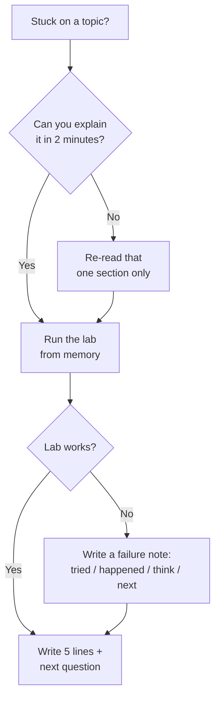

# Resources Map — One Picture, No Lost Links

Lab only · own machine · test data only

Don't collect 100 links. Use this map: topic → book → course/platform → lab. One row at a time.

## 1. The full map, in one diagram

## 2. Topic → book → course → lab

| Topic (roadmap file) | Book / reading | Course / platform | Lab you do |
|---|---|---|---|
| Computer basics | Linux + Python beginner book | Linux basics course | Own machine: `ps`, `ss`, lab folder checks |
| Linux filesystem | Linux basics book, filesystem chapters | TryHackMe Linux rooms | Own lab folder: paths, `ls -l`, permissions |
| Linux commands | Linux commands guide | TryHackMe / Academy Linux modules | `~/lab-test`: navigate, read, find, `chmod` |
| Network basics | Networking basics | Networking basics course | Own machine: `ping`, `ip`, `ss -tln`, localhost vs exposed |
| Network tools | Networking tools guide | TryHackMe networking rooms | Own machine + lab network only: `dig`, `curl`, `ss` |
| Web basics | Web basics guide | PortSwigger Academy, web basics | Localhost lab server: `python3 -m http.server 8000 --bind 127.0.0.1` |
| OWASP simple | OWASP Top 10 (official, free) | PortSwigger Academy, OWASP labs | Own lab app, test accounts only, A01–A10 one at a time |
| Tools overview | Tools guide, by job not by name | Academy tools modules | Own lab: question first, then tool, then output meaning |
| Recon tools | Recon guide | TryHackMe recon rooms, in scope | Lab targets only: DNS, WHOIS concept, browser dev tools |
| Web tools | Web tools guide | PortSwigger Academy | Own lab app: dev tools, `curl`, proxy in lab only |
| Password tools | Password security guide | Password / auth basics course | Test passwords only: strength checker, hash + salt concept |
| System tools | System audit guide | System basics course | Own machine only: OS, permissions, ports, updates |
| Safe labs | Safe lab guide (this repo, `06-password-system/`) | — | Build a lab: purpose, separation, test data, cleanup |
| Practice notes | Practice guide (this repo, `07-practice/`) | — | 5-line notes, failure notes, weekly review |
| Daily practice | Daily rhythm (this repo, `07-practice/`) | — | Morning + evening blocks, library light study, English recording |

## 3. If you're stuck, follow this

## 4. Link rules — keep your list clean

| Rule | Why |
|---|---|
| Max 3 links per topic, in your private notes | 100 links = no link ever opened |
| Official / legal sources only | No pirated books, courses, or tools |
| One link = one lab action | If a link has no lab action, it's not study, it's browsing |
| Re-check links monthly | Dead links, old tools, and changed platforms waste time |
| Never publish real accounts, tokens, or personal data with a link list | Scrub notes before sharing, placeholders only |

## 5. Your personal map — fill this in, privately

| My current phase | My book now | My course / platform now | My lab this week |
|---|---|---|---|
| _fill in, private notes only_ | _1 book at a time_ | _1 course / room at a time_ | _1 lab, with a write-up_ |

Update it every Friday, in 5 minutes. That's your progress, in one table — no app, no tracker, no extra tool needed.

Next after resources → Commit 10: glossary + final visual checklists, in the same visual style.

---
*Lab only: systems you own or have written permission to test, test data only. Official / legal sources only.*
