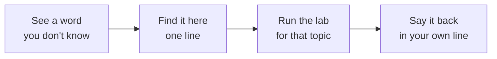

# Glossary — Visual Notes

Lab only · own machine · test data only

One line each. If you can't say it in one line, you don't own it yet — go back to that file, run the lab, then come back.

## A–C

| Word | Means, in one line |
|---|---|
| Access control | Who is allowed to do what, checked before it happens |
| API | A way for programs to talk to each other, usually over HTTP with JSON |
| Authentication | Proving who you are (password, key, code) |
| Authorization | What you're allowed to do, after authentication |
| Binary file | Data for a program, not readable as plain text |
| Cookie | Small data a site stores in your browser, sent back on later requests |
| CPU | The worker — runs instructions, one at a time, very fast |
| CSRF | A site tricking your browser into making a request you didn't intend — lab only, test app only |

## D–H

| Word | Means, in one line |
|---|---|
| Daemon / Service | A program running in the background, waiting for a job |
| DNS | The system that turns names like `example.com` into IP addresses |
| Encryption | Scrambling data so only someone with the key can read it |
| Endpoint | A URL + method that does one job in an API (e.g. `GET /users`) |
| Filesystem | How files and folders are laid out, starting at `/` on Linux |
| Firewall | A filter that allows or blocks network traffic by rules |
| Hash | A one-way fingerprint of data — you can't turn it back into the original |
| Header | Extra info sent with an HTTP request or response, not the body |
| HTTP / HTTPS | Web protocol / web protocol with encryption (TLS) |
| Host | A machine on a network, in lab terms usually your own machine |

## I–P

| Word | Means, in one line |
|---|---|
| Injection | Untrusted input treated as code — a classic web flaw, lab only |
| IP address | A machine's address on a network, e.g. `127.0.0.1` = your own machine |
| Kernel | Core of the OS — only part that touches hardware directly |
| Lab | A controlled place, separate from real life, with test data only |
| Localhost | Your own machine talking to itself (`127.0.0.1`) |
| Log | A record of events, in order, for checking what happened |
| MITRE ATT&CK | A public map of attacker tactics — a map, not a recipe |
| OWASP | A community project listing common web risks, Top 10 = the famous list |
| Packet | A small chunk of network data, with a source, a destination, and a payload |
| Path | An address in the filesystem tree, e.g. `/home/your-user/lab-test` |
| Payload | The data carried by a request / packet — in lab, test data only |
| Permission | Who can read, write, or execute a file: owner / group / others, `rwx` |
| PID | Process ID — the number the OS gives a running program |
| Port | A number on a machine that a service listens on, e.g. `8000`, `5432` |
| Process | A program, alive, with memory + PID |
| Proxy | A middleman that forwards requests — in lab, for inspecting your own lab traffic |

## R–Z

| Word | Means, in one line |
|---|---|
| RAM | The desk — holds what is running now, gone on power off |
| Recon | Gathering information about a target — lab targets / in-scope rooms only |
| Red team | Testing a system like an attacker would, with written permission, then reporting it |
| Salt | Random value added before hashing a password, different per user |
| Scope | Written permission: what you may test, and what you may not |
| Session | A logged-in state, usually tracked by a cookie or token, in lab with test accounts |
| Shell | Translator between your typed words and the OS (Bash on Linux) |
| Socket | A network endpoint: IP + port, listening or connected |
| SSRF | A server tricked into making a request you control — lab only, test app only |
| Subnet | A group of IP addresses on the same network segment |
| TCP / UDP | Reliable, ordered delivery / fast, unordered delivery — two transport protocols |
| Token | A secret value that proves a session or access — never publish it |
| TLS | Encryption for network traffic — what makes HTTPS secure |
| Vulnerability | A flaw that can be used to break a rule — in lab, a design lesson, not a weapon |
| Write-up | A finding written so someone else can understand it and fix it: finding, impact, evidence, fix |
| XSS | Untrusted input shown as code in a browser — lab only, test app only |

## How to use this glossary

Don't memorise this page. Use it as a lookup, while you lab. Words stick when you've run them, not when you've read them.

Next → `final-checklists.md` · `what-next.md`

---
*Lab only: systems you own or have written permission to test, test data only.*
