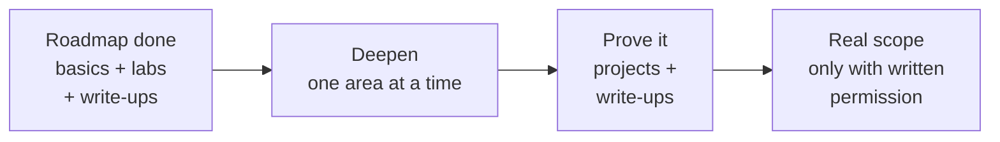
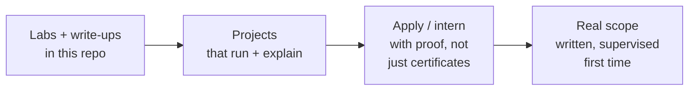
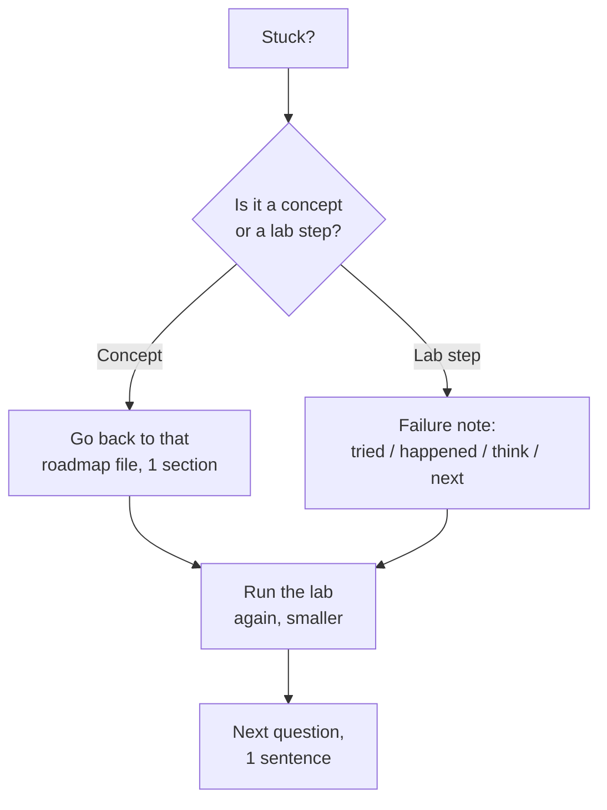

# What Next — Visual Notes

Lab only · own machine · test data only

You finished the roadmap files. That doesn't mean you're finished learning — it means you have a base, a lab habit, and proof you can explain. What next is: go deeper, in order, with scope, and keep building proof.

## 1. Where you are, in one diagram

| You have | You don't have yet | That's normal |
|---|---|---|
| Basics, labs, write-ups, a visual roadmap you can explain | Deep specialism, real-world experience, a job | Everyone starts here — depth comes next, over months |

## 2. Pick one deep area next — not all of them

| Area | Start with, in lab | Don't start with |
|---|---|---|
| Active Directory | Your own lab AD, in a VM, test accounts only | A real company network — never, without written scope |
| Cloud security | Your own free-tier lab account, with spending limits set | A real production account |
| Web security, deeper | Your own lab app + PortSwigger Academy, harder labs | Real sites, bug bounty without reading the program's scope first |
| Mobile security | Your own lab device / emulator, test apps only | Someone else's phone |
| Detection / blue team basics | Your own lab logs, what normal looks like, what an attack looks like in lab | — |

**Rule:** 1 area, 3 months, labs + write-ups, then review. Jumping areas every week = no depth anywhere.

## 3. Build 3 projects that prove it

| Project | What it shows | Lab only |
|---|---|---|
| 1 · Lab web app + security write-up | You can build, test, break (in lab), and fix a web app, and write it up | Own lab app, localhost, test accounts |
| 2 · System audit tool, improved | You can check a machine, explain output, and suggest fixes | Own machine only, scrubbed report |
| 3 · Recon + reporting, in a legal room | You can plan, stay in scope, gather, and report | TryHackMe / HackTheBox room, in scope only |

| Project proof, each one | Must have |
|---|---|
| Code / scripts that run | In your own repo, test data only |
| Write-up: finding, impact, evidence, fix | Plain English, scrubbed, placeholders only |
| What you learned, and what you'd do next | 5 lines, honest, no exaggeration |

## 4. Jobs, internships, and real scope — honest order

| Stage | Do | Don't do |
|---|---|---|
| Apply | Show labs, write-ups, projects — link this repo, explain one project in 2 minutes | Claim skills you can't demo in lab |
| Interview / test | Explain your lab work, your failures, and what you learned | Bluff a tool name you can't use |
| First real scope | Read the scope twice, ask questions, stay inside it, log everything | Test outside scope "just to check" |
| After a real test | Write the report the way you wrote lab write-ups: finding, impact, evidence, fix | Share real findings publicly without permission |

## 5. Keep learning, without burning out

| Habit | How |
|---|---|
| 1 lab session a day, focused | Morning or evening block, 1 question, 5-line note |
| 1 write-up a week | Lab finding, or a topic explained, in plain English |
| 1 review a week | Last week's task, from memory, with a small change |
| 1 new area per quarter | Not per week — depth, not collection |
| Rest, sleep, movement | Every day — a tired brain doesn't learn, and a burnt-out learner quits |

## 6. If you get stuck after the roadmap

**Last line, and the whole roadmap in one sentence:**
Learn it, lab it, write it, explain it — only in labs you own or have written permission to test, with test data only, and keep building proof you can explain.

That's the path. Keep going, one block at a time.

---
*Lab only: systems you own or have written permission to test, test data only. Real scope only with written permission.*
