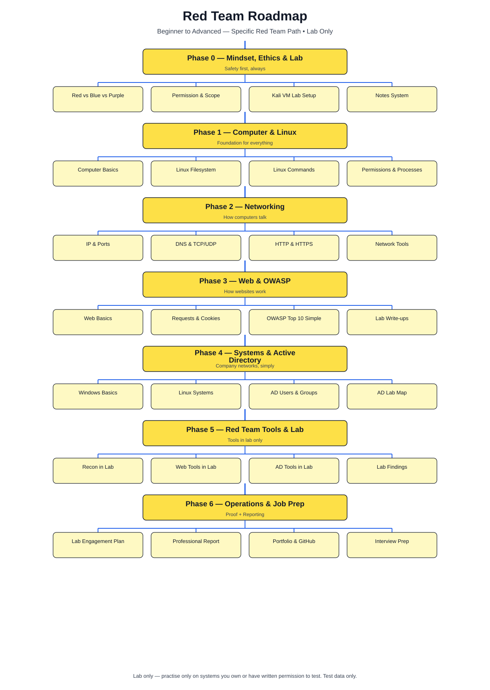
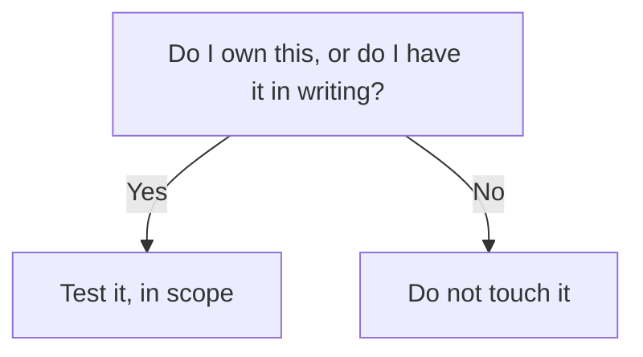
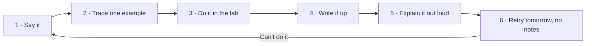

# Cybersecurity Red Team Roadmap — Visual Notes

Lab only · own machine/lab · test data only

What to learn, in what order, what proof each phase leaves. Red teaming is a trade: lab work, reading output, writing up findings.

## 1. Who this fits — and who it doesn't

| Fits you if… | Doesn't fit if… |
|---|---|
| You want real red team work, not certificates | You want shortcuts to real sites, accounts, or networks |
| You'll learn Linux, networking, web, systems — in order | You want to skip fundamentals and go straight to tools |
| You'll build proof: scripts, reports, write-ups | You want tool names without understanding their output |

## 2. The one rule, before anything else



- Only your own Kali VM, lab network, test site, test files — or a legal lab platform (TryHackMe, HackTheBox Academy, PortSwigger Academy), their lab machines only, by their rules. Never a real site, company/school network, or someone else's machine without written permission. Never real passwords or personal data — test data only, like `<test-password>`.

**Watch out:** an unscrubbed lab report can leak a hostname, username, or local ports. Read it as a stranger, strip private details, then publish.

## 3. How to learn a topic — the loop



| Step | "Done" looks like |
|---|---|
| Say it | The idea, in your own words |
| Trace it | Input → change → output, and why |
| Do it | Typed yourself, output watched, one change, rerun |
| Write it | Concept, steps, output meaning, snags, open questions |
| Explain it | Minutes, plain English, off-page |
| Retry it | Next morning, no notes — if you can, it's yours |

Watching feels like learning; it fades. Doing, breaking, writing, explaining sticks.

## 4. Roadmap at a glance

| Phase | Focus | Time | Core skills | Tools, concept first | Proof |
|---|---|---|---|---|---|
| 0 | Mindset, ethics, lab | 1 wk | Safety, scope, notes | Kali VM, terminal | Lab + scope note |
| 1 | Computer + Linux | 3–4 wks | OS, files, processes, permissions | ls, cat, grep, chmod, find | Linux notes, audit report |
| 2 | Networking | 3–4 wks | IP, DNS, ports, TCP/UDP, HTTP | ping, ss, ip, dig, Wireshark (lab) | Network notes, port check |
| 3 | Web + OWASP | 4–6 wks | Requests, cookies, sessions, OWASP | Dev tools, Burp (lab), curl | Web notes, write-ups |
| 4 | Systems + AD basics | 4–6 wks | Windows/Linux, users, services, AD | PowerShell, AD lab | Audit report, AD notes |
| 5 | Red team tools | 6–8 wks | Recon, lab access, escalation | Nmap, ffuf, Metasploit, BloodHound (lab) | Write-ups: findings + fixes |
| 6 | Operations, reporting, job prep | 4–6 wks | Planning, reporting, portfolio | Report template, GitHub | Polished write-ups |

Flexible times — move on when you can do a phase's work without notes and explain it cold. ~9–12 months steady work to employability. A very high salary in 12 months from zero is a stretch target, not a normal fresher outcome.

## 5. Why this order

| Rule | Why |
|---|---|
| Fundamentals before tools | A tool only asks a question. No system understanding → no answer reading (`ss -tln` = ports; unknown ports = just numbers) |
| Linux before hacking | Most work/targets are Linux/Windows servers. Can't navigate files, read permissions, check processes → can't test safely |
| Networks before web attacks | A website is a network service. DNS/IP/ports/HTTP understood → request in, response out, cookies/sessions holding state |
| One tool deep > ten shallow | Per tool: what, why, when not to, output line by line, one lab example |
| Notes before certificates | Employers check labs/write-ups/GitHub first. Weekly proof: running script, saved report, talkable write-up |
| Reporting = a red team skill | Finding a problem is half the job; writing it actionably is the other half |

## 6. Folder map — how this repo grows

- `01-roadmap/` — overview, how-to-learn
- `02-fundamentals/` — computer basics, Linux filesystem, commands
- `03-networks/` — network basics, network tools
- `04-web/` — web basics, OWASP
- `05-tools/` — tools overview, recon, web, password/system
- `06-practice/` — safe labs, practice notes
- `07-resources/` — books, courses, glossary

One big commit at a time. Empty folder = commit not landed yet.

## 7. Lab setup + ready check

| Piece | Setup |
|---|---|
| Main | Your own Kali VM (VirtualBox/VMware) |
| 2nd VM (optional) | Vulnerable target, private lab network only, never internet-exposed |
| Data | Test files/passwords you made yourself, only |
| Own code counts | Python password checker (test passwords only), or audit of own machine + localhost ports — save, read, explain it |

Never practise on real sites, company networks, public Wi-Fi, other people's computers, or anything without written permission.

**Ready for Phase 1 when:** you can say what a red team does/doesn't do off-page; Kali + terminal open, `python3 --version` runs; you've read `01-roadmap/overview.md` and `01-roadmap/how-to-learn.md`; one notes page in your own words exists. Any check fails → stay on Phase 0. Structured, not slow.

## 8. Lab pass — try it now

```bash
python3 --version
pwd
ls -l
whoami
```

Then write a one-page scope note: VMs, private lab network only, what you will/won't test.

**Done when:** you can state the one rule, run the loop, and name each phase's proof — without notes.

Next → `01-roadmap/overview.md`
---
*Educational use only. All practice must be on systems you own or have written permission to test.*
