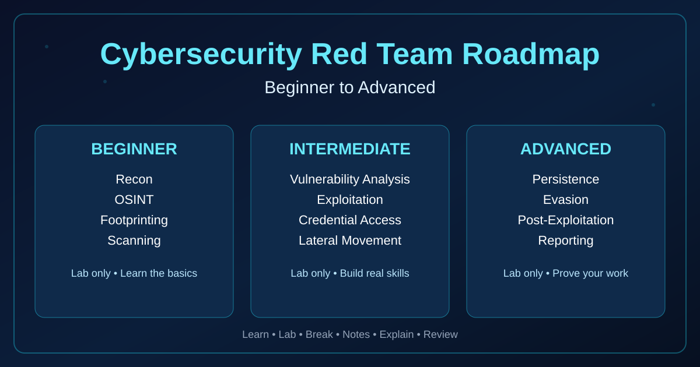

# Cybersecurity Red Team Roadmap

A specific path to becoming a red team professional, beginner to advanced. Not a general security notes dump. What to learn, in what order, why that order, which tools matter, and what proof you should have at the end of each phase. Red teaming is a trade: you learn it by doing lab work, reading output properly, and writing up what you found.

## Who this is for

This fits you if you want to do red team work for real, not collect certificates — if you're willing to learn Linux, networking, web, and systems in order, practise in labs, and build proof: scripts that run, audit reports you can explain, write-ups someone else can follow. It doesn't fit you if you want shortcuts to real websites, accounts, or networks, or if you want to skip fundamentals and go straight to tools. Tools without understanding produce noise, not findings.

## The one rule, before anything else

Practise only on systems you own, or systems you have written permission to test. Your own Kali VM. Your own lab network, your own test site, your own test files. Or a legal lab platform built for learning — TryHackMe, HackTheBox Academy, PortSwigger Academy.

Never scan or test a real site, a company network, a school network, or someone else's machine without written permission, and never practise with real passwords or real personal data. Every example here uses test data only, like `<test-password>`, and sample files you create yourself.

Watch out for one quiet trap: publishing a lab report without scrubbing it. It can leak your hostname, username, or local ports. Read it as a stranger would, and strip anything private before it goes public.

Unsure whether something is allowed? Ask: do I own this, or do I have it in writing? No means no.

## How to actually learn a topic

Don't read this repo cover to cover in a weekend. Work one topic at a time, and run the same loop every time.

First, get the idea in your own words. Read the concept file, then say it back in a sentence or two. If you can't, you haven't got it yet — read it again, slower. Moving on anyway builds on a gap you'll pay for later. Then trace one example: what went in, what came out, what changed and why. After that, do it yourself in your own lab. Type it, don't copy-paste blindly, watch the output, then change one small thing and run it again. That's where the thinking forms — you start seeing inputs, the parts the system trusts without checking, and the places it can fail.

Then write it up in your own words: the concept, the lab steps, what the output meant, what tripped you up, what you're still unsure about. Copied text isn't notes. Finally, explain it out loud in a couple of minutes, in plain English. If you stumble, that's the part to revisit. Next morning, try the lab again without your notes. If you can, it's yours. If not, repeat — that's the process working.

Watching videos feels like learning. It fades fast. Doing, breaking, writing, and explaining is what sticks. A professional isn't someone who knows a hundred tool names. It's someone who can look at a system, understand how it works, find where it can fail, test it safely in a lab, and write the finding so someone else can act on it.

## Roadmap at a glance

Full design lives in `01-roadmap/overview.md`. This is the map, not a shortcut.

| Phase | Focus | Rough time | Core skills | Tools, concept first | Proof you should have |
|-------|-------|------------|-------------|----------------------|------------------------|
| 0 | Mindset, ethics, lab setup | 1 week | Safety, scope, notes | Kali VM, terminal | Working lab, scope note |
| 1 | Computer and Linux fundamentals | 3–4 weeks | OS, files, processes, permissions | ls, cat, grep, chmod, find | Linux notes, audit report |
| 2 | Networking fundamentals | 3–4 weeks | IP, DNS, ports, TCP/UDP, HTTP | ping, ss, ip, dig, Wireshark (lab) | Network notes, port check |
| 3 | Web fundamentals and OWASP | 4–6 weeks | Requests, cookies, sessions, OWASP | Dev tools, Burp (lab), curl | Web notes, lab write-ups |
| 4 | Systems and Active Directory basics | 4–6 weeks | Windows/Linux, users, services, AD | PowerShell, AD lab (own lab) | Audit report, AD notes |
| 5 | Red team tools and techniques | 6–8 weeks | Recon, lab access, lab escalation | Nmap, ffuf, Metasploit (lab), BloodHound (lab) | Write-ups with findings, fixes |
| 6 | Operations, reporting, job prep | 4–6 weeks | Planning, reporting, portfolio | Report template, GitHub, resume | Polished write-ups, portfolio |

Times are flexible — they depend on your day and how much you practise. Don't rush a phase to hit a date; move on when you can do that phase's work again without notes and explain it cold. Roughly, this is 9 to 12 months of steady work to become genuinely employable. A very high salary in 12 months from zero is a stretch target, not a normal fresher outcome. The honest goal: real skills, real proof, clear communication. That's what gets interviews.

## Folder structure — how this repo grows

Built slowly, one big commit at a time.

```
Cybersecurity-RedTeam-Roadmap/
├── README.md
├── 01-roadmap/          # overview, how-to-learn
├── 02-fundamentals/     # computer basics, Linux filesystem, commands
├── 03-networks/         # network basics, network tools
├── 04-web/              # web basics, OWASP
├── 05-tools/            # tools overview, recon, web, password/system
├── 06-practice/         # safe labs, practice notes
└── 07-resources/        # books, courses, glossary
```

An empty folder just means that commit hasn't landed yet. Don't skip ahead to advanced tools before fundamentals are solid.

## Why the order is this order

Fundamentals before tools, because a tool only asks a system a question. If you don't understand the system, you can't read the answer. Take `ss -tln`: it lists listening ports. If you don't know what a port is, the output is just numbers. Learn ports first, and the tool starts making sense.

Linux before hacking, because most red team work happens on Linux and most targets run Linux or Windows servers. If you can't move through a filesystem, read permissions, and check processes, you can't test a system safely or explain a finding.

Networks before web attacks, because a website is a network service. Without DNS, IP, ports, and HTTP, web attacks look like magic. With them, web logic is straightforward: request in, response out, cookies and sessions holding state between requests.

One tool deep beats ten tools shallow. For each tool here, learn what it is, why you'd reach for it, when not to use it, what its output actually means line by line, and one safe lab example. That's more useful in a job than a list of a hundred tool names you can't explain.

Notes before certificates. Employers check labs, write-ups, and GitHub proof first, so build proof every week: a script that runs, a report that's saved, a write-up you can talk through. Reporting is a red team skill, not admin work at the end — finding a problem is half the job, writing it so someone can act on it is the other half.

## Lab setup

Start with your own Kali VM in VirtualBox or VMware. If you add a second VM as a vulnerable target, keep it on your own private lab network, never exposed to the internet, and use test files and test passwords you made yourself. Legal platforms are the other route — TryHackMe, HackTheBox Academy, PortSwigger Web Security Academy — but only touch the lab machines they give you, and follow their rules exactly.

Your own code counts too. A small Python password checker with test passwords only, or a system audit that checks only your own machine and localhost ports: save the report, read it, explain it. That's already red team practice — check, understand, report. Never practise on real websites, company networks, public Wi-Fi networks, other people's computers, or anything without written permission.

## Before you start Phase 1

You're ready when you can say, without reading it off a page, what a red team does and what it doesn't do; when your lab actually works — Kali opens, the terminal opens, `python3 --version` runs; when you've read `01-roadmap/overview.md` and `01-roadmap/how-to-learn.md` properly; and when you have a first notes page in your own words. If any of that isn't true yet, stay on Phase 0. That's not slow. That's structured.

## A note on honesty

This roadmap doesn't promise a job, a salary, or a certificate. It promises a clear path if you follow it honestly: learn, practise in labs, write notes, build proof, explain your work clearly. That's the difference between a professional hacker and someone who only watched hacking videos. Start with Phase 0. One step at a time. No shortcuts.

---

*Educational use only. All practice must be on systems you own or have written permission to test. This repo does not contain instructions to attack real systems.*
