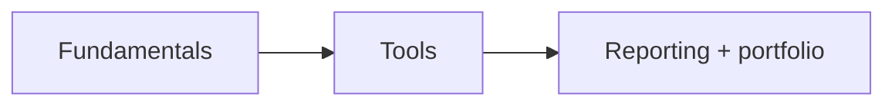
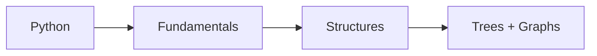

# Visual Roadmaps — Visual Notes

Lab only · own machine/lab · test data only

Two diagrams live here. Maps, not the work: see where you are + what's next, then do the reading + lab work behind that box. Looking at the picture is not learning it — doing the lab task from memory, without notes, is.

## 1. The Red Team diagram

File: `red-team-roadmap.svg` — open on GitHub, zoom in. Top to bottom, in order.

Linux before hacking; networks before web.

- Phase 0: Mindset, ethics, lab: red/blue/purple, scope, working Kali VM, notes you use (`01-roadmap/`)
- Phase 1: Computer + Linux: machine parts, filesystem, commands, permissions, processes (`02-fundamentals/`)
- Phase 2: Networking: IP + ports, DNS, TCP/UDP, HTTP/HTTPS, own-lab tools (`03-networks/`)
- Phase 3: Web + OWASP, simple, lab-bound (`04-web/`)
- Phase 4: Systems + AD: Windows/Linux systems, users + groups, your own private lab map (Own AD lab)
- Phase 5: Red team tools in the lab: recon, web, AD tools, scoped engagement, findings + fixes (Lab)
- Phase 6: Operations + job prep: plan, report, portfolio, interview prep (Portfolio)

**Phase 6 proof:** a few polished reports + a project explainable in 3 minutes — not tools you once ran.

One box at a time, finished properly, then move down. Can't do its lab task without looking? Not finished.

## 2. The DSA diagram

File: `data-structures-algorithms-roadmap.svg` — same style, different job. DSA is a supporting skill, roughly a fifth of the path, not the main road: data storage, memory, problem-solving steps.

- Python first: language of your password lab + system audit; most red team tooling is Python
- Programming fundamentals: variables, loops, functions, basic OOP — loop + function not clean? Back to fundamentals
- Data structures: Arrays + strings, linked lists, stacks + queues, hash tables (How data is stored)
- Big-O, just enough: Why approaches blow up: longer-password brute force grows exponentially; sort a big log before searching (Cost)
- Sorting + searching, trees, graphs: trees = filesystem, page structure; graphs = network, AD lab; BFS/DFS = reading a lab map
- Patterns, as ideas: two pointers, sliding window, recursion, dynamic programming

**Skip the deep end for now:** segment trees, advanced dynamic programming, deep tries, complex graph algorithms in full detail. Return only if a real project needs them.

**Time rule:** DSA with Python + labs, small pieces, 2–3× a week, ~30 min. The moment it eats all your time, back to Linux, networks, lab work.

## 3. Using both together

Weekdays: red team phase work. 2–3× a week: one short DSA box + small Python example. Saturday: one lab engagement + write-up. Sunday: review — which boxes can you explain without notes? Pick next week's focus.

Don't finish both diagrams in a month. Steady phases over 9–12 months, DSA basics alongside, beats a rushed month. Finished a box? Mark it in your own notes — your personal map beats any generic diagram.

## 4. Files in this folder

- `red-team-roadmap.svg` — the red team diagram.
- `data-structures-algorithms-roadmap.svg` — the DSA diagram.
- `index.html` — local viewer; GitHub won't run it as a website, but SVGs open directly there.

Original to this repo, not copied. Educational use only, lab only.
